# ClearNote End-to-End Application Flow & State Specification

This document details the complete end-to-end user journeys in ClearNote, from unauthenticated landing to final prescription dispatch and data deletion. Every step specifies preconditions, system actions, success results, and exhaustive failure modes.

---

## 1. Consultation Lifecycle State Machine

Consultations progress through discrete states defined in `backend/app/models/consultation.py:8` and orchestrated in `backend/app/services/consultation_service.py`.

```mermaid
stateDiagram-v2
    [*] --> PENDING : POST /consultations (Draft created)
    
    PENDING --> PROCESSING : WS /consultations/{id}/stream disconnect (Audio spooled to S3 & task enqueued)
    PENDING --> FAILED : WebSocket / S3 upload fails
    
    state PROCESSING {
        [*] --> TranscribingAudio : Deepgram nova-3-medical
        TranscribingAudio --> ExtractingSOAP : Groq llama-3.3-70b-versatile (fallback: llama-3.1-8b-instant)
        ExtractingSOAP --> RetrievingGuidelines : FastEmbed nomic-embed-text-v1.5 + pgvector HNSW
        RetrievingGuidelines --> EvaluatingInteractions : Groq llama-3.3-70b-versatile
        EvaluatingInteractions --> [*]
    }
    
    PROCESSING --> AWAITING_REVIEW : Extraction complete; clinical review required
    PROCESSING --> FAILED : Deepgram/LLM timeout, JSON parse error, or DB exception
    
    AWAITING_REVIEW --> COMPLETE : POST /consultations/{id}/approve (Doctor clinical review & sign-off)
    AWAITING_REVIEW --> AWAITING_REVIEW : PATCH /consultations/{id} (Clinician edits note/meds)
    
    COMPLETE --> COMPLETE : PATCH /consultations/{id} (Clinician edits note/meds)
    COMPLETE --> COMPLETE : POST /consultations/{id}/prescription (PDF generated)
    COMPLETE --> [*] : Deleted via GDPR/HIPAA Erasure
```

---

## 2. End-to-End Step Execution Table

| Step # | Stage & Trigger | Preconditions | System Action | Success Result | Failure Results & Edge Cases |
| :--- | :--- | :--- | :--- | :--- | :--- |
| **01** | **Landing Page** User navigates to `/` (`frontend/src/app/page.tsx:1`) | None (Public route). | Next.js renders marketing hero, features, workflow guide, and interactive `ClinicalPreviewSimulator`. Checks Clerk session token. | Landing page displayed. If signed in, "Go to Dashboard" CTA appears. | **Offline / Network Loss**: Browser shows offline network error. **Asset Failure**: Hero animations degrade gracefully to static CSS. |
| **02** | **Clinician Sign-In / Sign-Up** User clicks "Sign In" or "Get Started" (`frontend/src/app/sign-in/`) | Valid network connection. | Clerk hosted UI (`<SignIn />`) mounts; validates email/password, OAuth, or MFA. Emits RS256 JWT session token upon success. | User authenticated in Clerk. Redirected to `/dashboard` or `/onboarding`. | **Invalid Credentials**: Clerk displays inline auth error. **Session Expiry**: User prompted to re-enter credentials. **Auth Service Outage**: Clerk iframe/API unreachable; user receives connection error. |
| **03** | **Doctor Onboarding Check** Browser sends `GET /doctors/me` (`frontend/src/app/(site)/layout.tsx:1`) | User has valid Clerk JWT in `Authorization: Bearer <token>`. | `get_current_user` (`auth.py`) verifies JWT via Clerk JWKS. Query executes: `SELECT * FROM doctors WHERE clerk_user_id = :id`. | If doctor record exists, user proceeds to `/dashboard`. If 404, user redirected to `/onboarding`. | **Missing / Expired Token**: Backend returns `401 Unauthorized`. Frontend redirects to `/sign-in`. **DB Connection Failure**: Backend returns `500 Internal Server Error`. Frontend displays error toast. |
| **04** | **Doctor Profile Setup** Clinician fills 3-step wizard on `/onboarding` (`frontend/src/app/onboarding/page.tsx:1`) | Authenticated Clerk user without existing onboarded `Doctor` profile. | Form validates: Specialty, License Number, Phone, Clinic Address via Zod and signature canvas. Submits `PATCH /doctors/onboarding` (`doctors.py:15`) and `POST /doctors/me/signature`. | Doctor profile onboarded (`200 OK`). User redirected to `/dashboard`. | **Validation Errors**: Missing required license or invalid phone formats block submission with red inline field errors. **Already Onboarded**: Backend returns `400 Bad Request`. **Timeout**: Mutation retries or surfaces Sonner toast. |
| **05** | **Dashboard Roster & Stats** User lands on `/dashboard` (`frontend/src/app/(site)/dashboard/page.tsx:1`) | Authenticated Doctor with active DB profile. | Parallel TanStack Query calls: `useDoctorStats`, `useConsultations`, `usePatients`. Upstash Redis checked first; on miss, queries Neon PostgreSQL. | Summary metrics (Total Consultations, Completed, Patients, Pending) and recent lists render. | **Empty State**: Displays "No consultations recorded yet" with "Start Consultation" CTA. **Cache Down**: Upstash falls back transparently to direct SQL query. **Session Expired**: TanStack Query intercepts 401 and invokes Clerk `signOut()`. |
| **06** | **Patient Creation & Consent** Clinician clicks "New Patient" (`CreatePatientModal.tsx:1`) | Clinician on Dashboard. | Submits `POST /patients` (`patients.py:18`) with name, DOB, gender, phone, email, medical history, allergies `text[]`, medications `text[]`, and consent checkbox. | Patient record persisted with `consent_recorded=true` and `consent_date=NOW()`. Roster refreshes. | **Missing Consent**: If checkbox unchecked, form validation blocks submission with "Patient consent is mandatory". **Invalid Age / Date**: Zod prevents future dates. **Network Loss**: Modal remains open with inputs preserved; error toast displayed. |
| **07** | **Initiate Consultation** Clinician selects Patient and clicks "Start Consultation" | Existing patient selected in `SelectPatientModal.tsx`. | Clinician triggers `POST /consultations` with `patient_id`. Backend creates consultation in `PENDING` state. | Consultation ID returned. `AudioRecorderModal.tsx` mounts immediately. | **Patient Not Found**: 404 error if patient deleted by another tab. **Cross-Tenant Denial**: If patient belongs to another doctor, backend rejects request (`404 / 403`). |
| **08** | **Live Audio Capture & Streaming** Clinician clicks "Start Recording" (`AudioRecorderModal.tsx:1`) | Browser microphone permission granted (`navigator.mediaDevices.getUserMedia`). | Next.js opens WebSocket to `ws://localhost:8000/consultations/{id}/stream?token=<clerk_jwt>`. Backend validates Clerk JWT and doctor ownership (`consultations.py:149`), then spools incoming audio chunks to a 5 MB `tempfile.SpooledTemporaryFile`. | Audio bytes stream continuously to the backend without unbounded heap growth. | **Unauthorized / Unowned**: WS rejects with `1008 Policy Violation`. **Mic Blocked**: Browser displays "Microphone permission denied" prompt. **WebSocket Disconnect**: On close, backend uploads any captured audio (>0 bytes). |
| **09** | **Finish Recording & S3 Ingestion** Clinician clicks "Finish Consultation" (`AudioRecorderModal.tsx`) | Recording active with > 0 bytes audio captured. | Client closes WebSocket stream. Backend rewinds the spooled file, uploads audio to AWS S3 (`AUDIO_BUCKET_NAME`), sets status to `PROCESSING`, and runs `_run_transcription` in `BackgroundTasks`. | Modal closes; frontend polls `GET /consultations/{id}` until status leaves `PROCESSING`. | **S3 / Processing Error**: Backend logs exception, marks consultation `FAILED` with `processing_error`. **Empty Audio**: If 0 bytes recorded, no background job is triggered. |
| **10** | **Background AI Extraction & Safety Verification** Executed asynchronously by `_run_transcription` | Consultation in `PROCESSING` status with `audio_s3_key`. | Background worker (`consultation_service.py`): 1. Downloads audio from S3 and transcribes via Deepgram `nova-3-medical`. 2. Groq `llama-3.3-70b-versatile` (fallback `llama-3.1-8b-instant`) extracts SOAP note, medications, ICD-10 using `<untrusted_clinical_dialogue>` prompt injection delimiters. 3. FastEmbed (`nomic-embed-text-v1.5`) embeds pairwise drug query. 4. `pgvector` HNSW index retrieves top-3 guideline chunks. 5. Groq evaluates drug interactions; caps confidence `<= 0.5` if zero local chunks match, or creates `MODERATE` caution alert (`confidence=0.0`) on LLM failure. 6. Commits records and sets status to `AWAITING_REVIEW`. | Consultation status becomes `AWAITING_REVIEW`. Clinical note, diagnoses, medications, and interaction cards populate UI awaiting physician review. | **Deepgram/LLM Rate Limit or Timeout**: Status set to `FAILED` with diagnostic `processing_error`. **Zero Local Chunks**: Confidence capped `<= 0.5` and annotated `"(Unverified in local guidelines)"`. **Duplicate Trigger**: Idempotency guard aborts if already `PROCESSING`, `AWAITING_REVIEW`, or `COMPLETE`. |
| **11** | **Clinical Review & Doctor Approval (Human-in-the-Loop)** Clinician audits extracted note on Consultation Detail page | Consultation status `AWAITING_REVIEW`. | Clinician audits Subjective, Objective, Assessment, Plan, diagnoses, medications, and drug interactions. Can edit any field via `PATCH /consultations/{id}` (which re-runs RAG on updated meds). When verified, doctor clicks "Approve & Sign Off", calling `POST /consultations/{id}/approve`. | Status transitions to `COMPLETE`. Unlocks prescription generation. Consultation cache cleared in Redis. | **Unapproved Prescription Block**: Attempting to generate prescription while status is not `COMPLETE` is rejected with `400 Bad Request`. **Concurrency Conflict**: Last write wins on concurrent edits. |
| **12** | **Prescription Generation & S3 Storage** Clinician clicks "Generate Prescription PDF" | Consultation `COMPLETE` with SOAP note present. | Calls `POST /consultations/{id}/prescription`. `pdf_service.py` compiles `prescription_template.html` using WeasyPrint, uploads PDF to `PDF_BUCKET_NAME`, generates signed HMAC access token and S3 pre-signed URL, and emails link if patient email exists. | Returns JSON with `url` (pre-signed S3 URL), `token`, and `share_url`. | **WeasyPrint System Error**: Missing Pango/Cairo libraries raises 500. **Missing SOAP Note**: Returns `400 Bad Request`. |
| **13** | **Prescription Notification Dispatch** Automatic on prescription generation (or webhook callbacks) | Generated PDF exists in S3; patient has valid email/phone. | `notification_service.py` dispatches prescription link via SendGrid email; Twilio SMS helpers support dosage reminders. | Patient receives prescription notification. | **Twilio / SendGrid Auth Error**: Logged to backend without crashing prescription generation. **Missing Patient Contact**: Skipped gracefully if email/phone null. |
| **14** | **Public Prescription Access** Patient or Pharmacist opens `GET /consultations/public/{id}/prescription?token=<signed_token>` | Valid consultation UUID and valid signed HMAC token. | Backend verifies HMAC token and signature expiry (7 days). Enforces rate limit (10/min). Generates S3 pre-signed URL and issues HTTP 307 Temporary Redirect (`consultations.py:34`). | Patient/Pharmacist browser streams PDF directly from AWS S3. | **Invalid / Expired Token**: Returns 401 Unauthorized. **Invalid Consultation ID**: Returns 404 Not Found. **PDF Not Yet Generated**: Returns 404 Not Found (`"Prescription not generated yet."`). **Rate Limit Exceeded**: Returns 429 Too Many Requests. |
| **15** | **Patient Right to Erasure (GDPR / HIPAA)** Clinician submits `POST /data-deletion/` (`data_deletion.py:20`) | Patient exists and belongs to current authenticated doctor. Rate limit (10/min). | Backend verifies `patient.doctor_id == current_doctor.id`. Creates `data_deletion_requests` record with `PENDING` status. On `POST /data-deletion/{id}/process`, purges S3 audio/PDFs and deletes patient/consultation DB records, marking request `PROCESSED`. | Request created (`201 Created`) and processed with S3 + DB cascade under tenant isolation. | **Unowned Patient**: 404 Not Found prevents cross-tenant erasure. **Rate Limit**: 429 if requests exceed 10/min. |
| **16** | **Session Termination / Logout** Clinician clicks "Log Out" in profile dropdown | Active Clerk session. | Clerk client invokes `signOut()`. Deletes local cookies, clears React Query cache, resets state. | User returned to unauthenticated landing page `/`. | **Network Failure**: Clerk clears local cookies client-side immediately regardless of upstream server reachability. |
