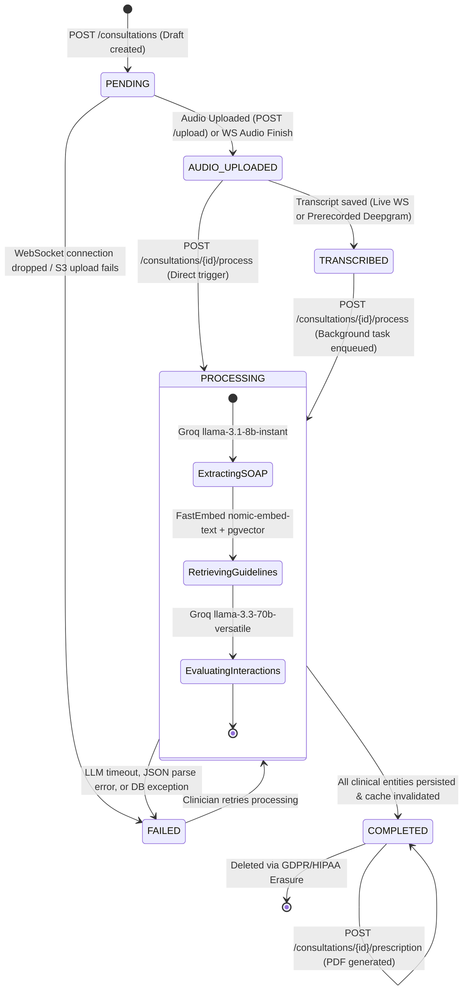

# ClearNote End-to-End Application Flow & State Specification

This document details the complete end-to-end user journeys in ClearNote, from unauthenticated landing to final prescription dispatch and data deletion. Every step specifies preconditions, system actions, success results, and exhaustive failure modes.

---

## 1. Consultation Lifecycle State Machine

Consultations progress through discrete states defined in `backend/app/models/consultation.py:19` and orchestrated in `backend/app/services/consultation_service.py`.

---

## 2. End-to-End Step Execution Table

| Step # | Stage & Trigger | Preconditions | System Action | Success Result | Failure Results & Edge Cases |
| :--- | :--- | :--- | :--- | :--- | :--- |
| **01** | **Landing Page** User navigates to `/` (`frontend/src/app/page.tsx:1`) | None (Public route). | Next.js renders marketing hero, features, workflow guide, and interactive smooth scroll (`lenis`). Checks Clerk session token. | Landing page displayed. If signed in, "Go to Dashboard" CTA appears. | **Offline / Network Loss**: Browser shows offline dinosaur or network error page. **Asset Failure**: Hero animations degrade gracefully to static CSS. |
| **02** | **Clinician Sign-In / Sign-Up** User clicks "Sign In" or "Get Started" (`frontend/src/app/sign-in/`) | Valid network connection. | Clerk hosted UI (`<SignIn />`) mounts; validates email/password, OAuth, or MFA. Emits RS256 JWT session token upon success. | User authenticated in Clerk. Redirected to `/dashboard` or `/onboarding`. | **Invalid Credentials**: Clerk displays inline auth error. **Session Expiry**: User prompted to re-enter credentials. **Auth Service Outage**: Clerk iframe/API unreachable; user receives connection error. |
| **03** | **Doctor Onboarding Check** Browser sends `GET /doctors/me` (`frontend/src/app/(site)/layout.tsx:1`) | User has valid Clerk JWT in `Authorization: Bearer <token>`. | `get_current_user` (`auth.py:27`) verifies JWT via Clerk JWKS. Query executes: `SELECT * FROM doctors WHERE clerk_id = :id`. | If doctor record exists, user proceeds to `/dashboard`. If 404, user redirected to `/onboarding`. | **Missing / Expired Token**: Backend returns `401 Unauthorized`. Frontend redirects to `/sign-in`. **DB Connection Failure**: Backend returns `500 Internal Server Error`. Frontend displays error toast. |
| **04** | **Doctor Profile Setup** Clinician fills 3-step wizard on `/onboarding` (`frontend/src/app/onboarding/page.tsx:1`) | Authenticated Clerk user without existing `Doctor` row. | Form validates: Specialty, License Number, Phone, Clinic Address via Zod. Submits `POST /doctors` (`doctors.py:25`). Inserts into `doctors` table. | Doctor record created (201 Created). User redirected to `/dashboard`. | **Validation Errors**: Missing required license or invalid phone formats block submission with red inline field errors. **Duplicate License / Email**: Backend raises `409 Conflict`. **Timeout**: Mutation retries or surfaces Sonner toast. |
| **05** | **Dashboard Roster & Stats** User lands on `/dashboard` (`frontend/src/app/(site)/dashboard/page.tsx:1`) | Authenticated Doctor with active DB profile. | Parallel TanStack Query calls: `useDoctorStats`, `useConsultations`, `usePatients`. Upstash Redis checked first; on miss, queries Neon PostgreSQL. | Summary metrics (Total Consultations, Completed, Patients, Pending) and recent lists render. | **Empty State**: Displays "No consultations recorded yet" with "Start Consultation" CTA. **Cache Down**: Upstash falls back transparently to direct SQL query. **Session Expired**: TanStack Query intercepts 401 and invokes Clerk `signOut()`. |
| **06** | **Patient Creation & Consent** Clinician clicks "New Patient" (`CreatePatientModal.tsx:1`) | Clinician on Dashboard. | Submits `POST /patients` (`patients.py:18`) with name, DOB, gender, phone, email, medical history, allergies `text[]`, medications `text[]`, and consent checkbox. | Patient record persisted with `consent_recorded=true` and `consent_date=NOW()`. Roster refreshes. | **Missing Consent**: If checkbox unchecked, form validation blocks submission with "Patient consent is mandatory". **Invalid Age / Date**: Zod prevents future dates. **Network Loss**: Modal remains open with inputs preserved; error toast displayed. |
| **07** | **Initiate Consultation** Clinician selects Patient and clicks "Start Consultation" | Existing patient selected in `SelectPatientModal.tsx`. | Clinician triggers `POST /consultations` with `patient_id`. Backend creates consultation in `PENDING` state. | Consultation ID returned. `AudioRecorderModal.tsx` mounts immediately. | **Patient Not Found**: 404 error if patient deleted by another tab. **Cross-Tenant Denial**: If patient belongs to another doctor, backend rejects request (`404 / 403`). |
| **08** | **Live Audio Capture & Streaming** Clinician clicks "Start Recording" (`AudioRecorderModal.tsx:1`) | Browser microphone permission granted (`navigator.mediaDevices.getUserMedia`). | Next.js opens WebSocket to `ws://localhost:8000/consultations/{id}/stream`. Backend initializes Deepgram Live client (`nova-3-medical`). Audio chunks piped in real-time. | Audio visualizer animates. Interim transcript streams into UI with `< 500ms` latency. | **Mic Blocked**: Browser displays "Microphone permission denied" prompt. **WebSocket Dropped**: Disconnect event caught; UI notifies user and offers "Reconnect" or "Upload Prerecorded File" fallback. **Deepgram Quota Exceeded**: Stream closes with error code; consultation marked `FAILED`. |
| **09** | **Finish Recording & Ingestion** Clinician clicks "Finish Consultation" (`AudioRecorderModal.tsx`) | Recording active with > 0 bytes audio captured. | Client sends `{"type": "stop"}` over WS. Backend uploads raw audio buffer to AWS S3 (`clearnote-audio-s3`), saves final transcript, and updates consultation status to `AUDIO_UPLOADED`. | Modal closes. Consultation list shows `AUDIO_UPLOADED`. Triggers `POST /consultations/{id}/process`. | **S3 Upload Timeout**: Backend logs error; saves transcript locally to DB and sets status to `AUDIO_UPLOADED` (with null audio URL) to prevent data loss. **Empty Audio**: If 0 bytes recorded, backend halts transition with error. |
| **10** | **Background AI Extraction & Safety Verification** Automatic or manual trigger of `POST /consultations/{id}/process` | Consultation status `AUDIO_UPLOADED` or `TRANSCRIBED`. | Backend returns 202 Accepted. Enqueues `process_consultation_background` (`consultation_service.py:270`): 1. Groq `llama-3.1-8b` extracts SOAP note, medications, ICD-10. 2. FastEmbed embeds query vector. 3. pgvector retrieves top 3 guideline chunks. 4. Groq `llama-3.3-70b` evaluates drug interactions. 5. Records committed to DB; status updated to `COMPLETED`. | Consultation status becomes `COMPLETED`. Detailed clinical note, diagnoses, medications, and interaction cards populate UI. | **LLM Rate Limit (429) / Timeout**: Status set to `FAILED`. UI shows "AI Extraction Failed - Click to Retry". **Empty Transcript**: If transcript contains only silence, LLM returns empty schema; saved with blank SOAP note. **Low Retrieval Confidence**: If guideline distance `>= 0.70`, no chunks used; LLM evaluates with general knowledge and flags "Guideline unverified". **Worker Crash**: In-memory task aborted; consultation remains in `PROCESSING` until manual retry. |
| **11** | **Clinical Review & Edit (Human-in-the-Loop)** Clinician reviews extracted note on Consultation Detail page | Consultation status `COMPLETED`. | Clinician audits Subjective, Objective, Assessment, Plan, diagnoses, and medications. Can edit any field and submit `PUT /consultations/{id}`. | Updates saved to `soap_notes`, `medications`, and `diagnoses`. Consultation cache cleared in Redis. | **Concurrency Conflict**: If two browser tabs submit updates simultaneously, last write wins (no optimistic locking version check currently in DB schema). **Validation Failure**: Empty medication name or invalid ICD-10 syntax caught by Pydantic schema. |
| **12** | **Prescription Generation & S3 Storage** Clinician clicks "Generate Prescription PDF" (`usePrescription.ts:1`) | Consultation `COMPLETED` with at least 1 prescribed medication. | Calls `POST /consultations/{id}/prescription`. `pdf_service.py:28` compiles `prescription_template.html` using WeasyPrint, uploads PDF to `clearnote-pdfs-s3`, generates 1-hour pre-signed URL. | Returns JSON with pre-signed download URL. PDF opens in new tab or downloads directly. | **WeasyPrint System Error**: Missing Pango/Cairo libraries raises 500. **S3 IAM Denial**: 500 S3 error; prescription PDF URL remains null. **No Medications**: Endpoint generates prescription with blank Rx section or returns validation warning. |
| **13** | **Prescription Notification Dispatch** Doctor clicks "Send to Patient" or toggles auto-send | Generated PDF exists in S3; patient has valid phone/email. | Calls `notification_service.py:18`. SendGrid sends email with prescription link; Twilio sends SMS with short URL. | Patient receives notification on their personal device. Clinician UI shows "Dispatched via SMS/Email". | **Twilio / SendGrid Auth Error**: Logged to backend; user notified "Prescription created, but SMS/Email dispatch failed". **Missing Patient Contact**: Skipped gracefully if phone/email null. |
| **14** | **Public Prescription Access** Patient or Pharmacist opens `GET /consultations/public/{id}/prescription` | Valid consultation UUID. | Backend checks consultation status and existence of `prescription_pdf_url`. Generates S3 pre-signed URL and issues HTTP 307 Temporary Redirect (`consultations.py:30`). | Patient/Pharmacist browser streams PDF directly from AWS S3. | **Invalid Consultation ID**: Returns 404 Not Found. **PDF Not Yet Generated**: Returns 400 Bad Request ("Prescription PDF not generated yet"). **Security Flaw**: Endpoint has no token expiry or rate limiting (allows UUID guessing if unconstrained). |
| **15** | **Patient Right to Erasure (GDPR / HIPAA)** Compliance officer submits `POST /data-deletion/request` (`data_deletion.py:18`) | Patient exists. Authenticated doctor or admin. | Backend verifies patient, creates `data_deletion_requests` record, purges S3 audio and PDF keys via Boto3, cascades deletes across `consultations`, `soap_notes`, `medications`, `diagnoses`, `interactions`, and `patients`. | Data completely erased from DB and S3. Request status marked `COMPLETED` (200 OK). | **S3 Delete Failure**: DB rollback prevents partial deletion state. **Cross-Tenant ID**: Endpoint currently does not verify `patient.doctor_id == current_doctor.id` (Security gap). |
| **16** | **Session Termination / Logout** Clinician clicks "Log Out" in profile dropdown | Active Clerk session. | Clerk client invokes `signOut()`. Deletes local cookies, clears React Query cache, resets state. | User returned to unauthenticated landing page `/`. | **Network Failure**: Clerk clears local cookies client-side immediately regardless of upstream server reachability. |
