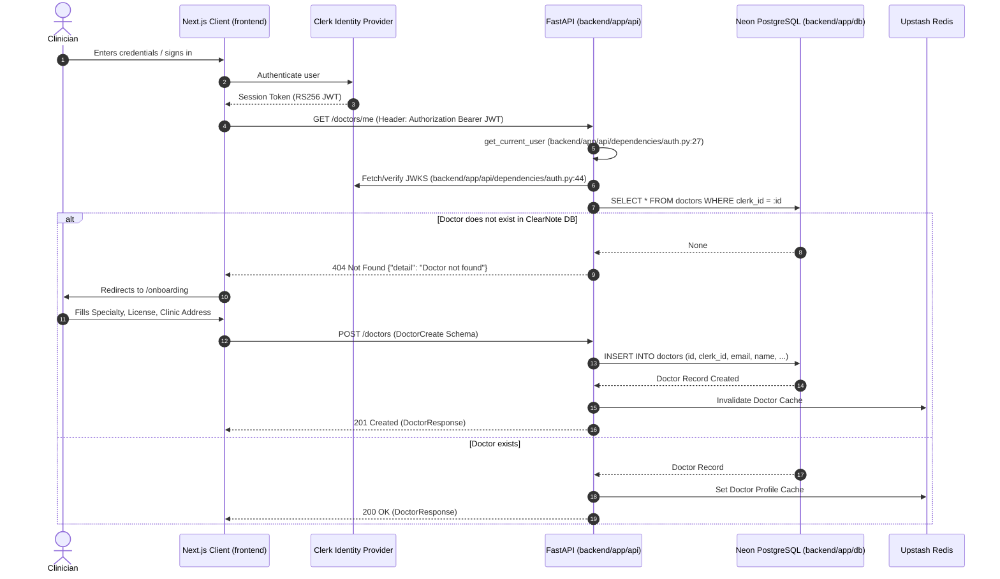
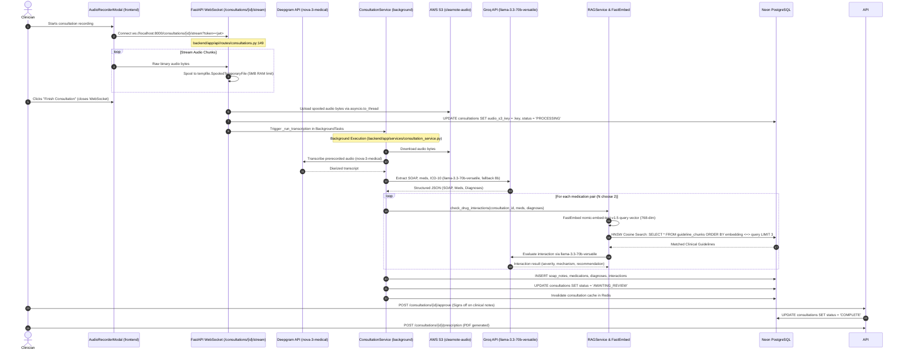
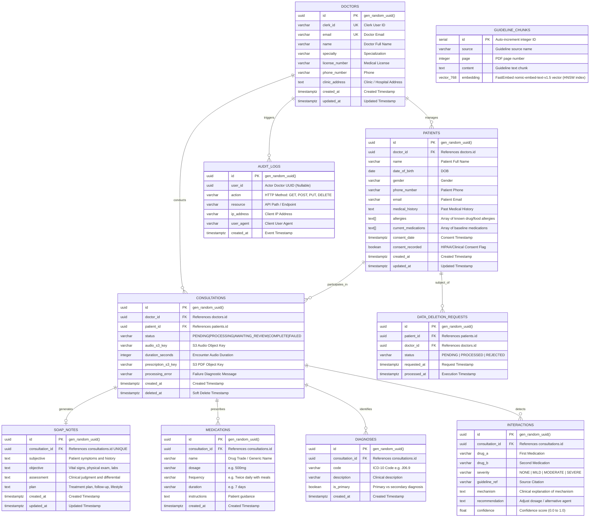
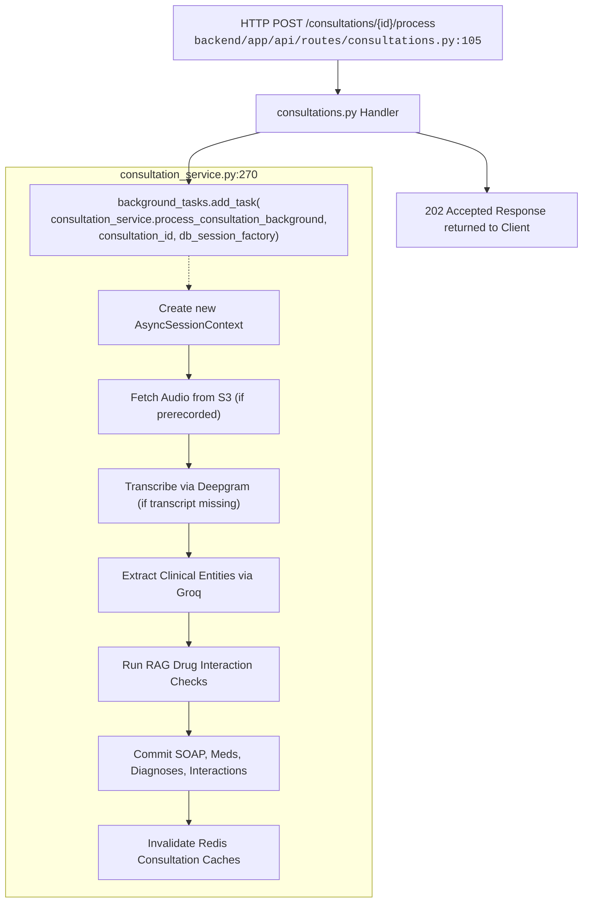

# ClearNote System Architecture

This document provides a comprehensive technical overview of the ClearNote architecture. All statements and diagrams are derived directly from the ClearNote codebase (`backend/` and `frontend/`).

---

## 1. System Context & Component Architecture

ClearNote is an AI-assisted clinical documentation and prescription workflow platform. It records physician-patient consultations, streams audio to speech-to-text models, extracts structured clinical SOAP notes using Large Language Models (LLMs), checks drug interactions against medical guidelines retrieved via vector embeddings (RAG), and generates PDF prescriptions.

```mermaid
flowchart TB
    subgraph ClientLayer ["Client Layer (Browser)"]
        FE["Next.js 16 Web App<br/>(React 19, Tailwind CSS v4)<br/><code>frontend/src/app</code>"]
    end

    subgraph AuthLayer ["Identity & Auth Layer"]
        CLERK["Clerk Auth Service<br/>JWT RS256 Verification<br/><code>backend/app/api/dependencies/auth.py</code>"]
    end

    subgraph APILayer ["Application Gateway & API Layer"]
        API["FastAPI 0.136.3 REST & WS API<br/><code>backend/app/main.py</code>"]
        MW["Security & Audit Middleware<br/><code>backend/app/middleware/security_header.py</code>"]
        API --- MW
    end

    subgraph AsyncPipeline ["Async Background Workers"]
        BG["FastAPI In-Memory BackgroundTasks<br/><code>backend/app/services/consultation_service.py</code>"]
    end

    subgraph DataStorage ["Data & Storage Layer"]
        DB[("Neon Serverless PostgreSQL 16<br/>+ pgvector Extension<br/><code>backend/app/db/session.py</code>")]
        REDIS[("Upstash Redis (REST)<br/>Distributed Caching<br/><code>backend/app/services/cache_service.py</code>")]
        S3[("AWS S3 / S3-Compatible Object Store<br/>Buckets: Audio & Prescriptions<br/><code>backend/app/services/s3_service.py</code>")]
    end

    subgraph ExternalAI ["External AI & Integration Services"]
        DG["Deepgram Nova-3 Medical STT<br/>WebSocket Audio Streaming<br/><code>backend/app/services/deepgram_service.py</code>"]
        GROQ_EXTRACT["Groq LLM (llama-3.3-70b-versatile, fallback: 8b)<br/>SOAP Extraction<br/><code>backend/app/services/llm_service.py</code>"]
        GROQ_RAG["Groq LLM (llama-3.3-70b-versatile)<br/>Interaction Evaluation<br/><code>backend/app/services/rag_service.py</code>"]
        FE_EMBED["FastEmbed (Local CPU)<br/>nomic-embed-text-v1.5 (768-dim)<br/><code>backend/app/services/rag_service.py</code>"]
        NOTIF["SendGrid & Twilio<br/>Email & SMS Delivery<br/><code>backend/app/services/notification_service.py</code>"]
    end

    FE -->|Clerk Bearer JWT| API
    FE -->|Direct Clerk Auth| CLERK
    API -->|Verify Public Key / JWKS| CLERK
    API -->|Execute Sync Routes| DB
    API -->|Read/Write Cache| REDIS
    API -->|Audio Upload / PDF Download| S3
    API -->|Enqueue Task| BG
    API <-->|WebSocket Audio Chunks| DG
    
    BG -->|Upload Final Audio| S3
    BG -->|Transcribe Prerecorded| DG
    BG -->|Extract Clinical SOAP| GROQ_EXTRACT
    BG -->|Embed Query Vector| FE_EMBED
    BG -->|Cosine Search <=>| DB
    BG -->|Verify Interactions| GROQ_RAG
    BG -->|Generate PDF WeasyPrint| S3
    BG -->|Send Notification| NOTIF
    BG -->|Persist Clinical State| DB
    BG -->|Invalidate Entity Cache| REDIS
```



### Component Inventory & Responsibilities

| Component | Source Reference | Technology | Primary Function |
| :--- | :--- | :--- | :--- |
| **Frontend Web App** | `frontend/src/app` | Next.js 16.2.6 (App Router), React 19, TanStack Query 5 | Doctor portal, audio recorder, consultation editor, patient management |
| **API Server** | `backend/app/main.py:1` | FastAPI 0.136.3, Uvicorn 0.48+ | REST endpoints, WebSocket streaming, middleware orchestration |
| **Authentication** | `backend/app/api/dependencies/auth.py:27` | Clerk SDK / JWT verification | Decodes and validates RS256 JWTs using Clerk JWKS public keys |
| **Relational & Vector DB** | `backend/app/db/session.py:13` | Neon PostgreSQL 16 + pgvector | Persistent relational clinical records and 768-dim vector embeddings |
| **Object Storage** | `backend/app/services/s3_service.py:27` | AWS S3 via Boto3 (`asyncio.to_thread`) | Binary audio recordings (`clearnote-audio`) and PDF prescriptions (`clearnote-pdfs`) |
| **Cache Layer** | `backend/app/services/cache_service.py:18` | Upstash Redis via REST (`upstash-redis`) | Cache-aside layer for doctor profiles, patient rosters, consultation views |
| **Speech-to-Text (STT)** | `backend/app/services/deepgram_service.py:62` | Deepgram SDK (`nova-3-medical`) | Prerecorded consultation audio transcription (with WebSocket streaming entrypoint) |
| **Clinical Extraction LLM** | `backend/app/services/llm_service.py:19` | Groq API (`llama-3.3-70b-versatile`, fallback `llama-3.1-8b-instant`) | Structured JSON extraction of SOAP notes, medications, ICD-10 codes |
| **Interaction RAG LLM** | `backend/app/services/rag_service.py:140` | Groq API (`llama-3.3-70b-versatile`) | Evaluates pairwise drug-drug interactions against retrieved chunks |
| **Local Embedding Engine** | `backend/app/services/rag_service.py:27` | FastEmbed (`nomic-ai/nomic-embed-text-v1.5`)| Runs dense 768-dimensional text embeddings locally on host CPU |
| **Prescription Engine** | `backend/app/services/pdf_service.py:6` | WeasyPrint 69.0+ + Jinja2 | Renders PDF prescriptions from HTML templates (`prescription_template.html`) |
| **Notification Engine** | `backend/app/services/notification_service.py:18`| SendGrid & Twilio SDKs | Dispatches prescription links via transactional email and SMS |

---

## 2. Request Lifecycle & Sequence Diagrams

### 2.1 Doctor Authentication & Profile Provisioning Flow



### 2.2 Audio Streaming, Transcription & Clinical Extraction Flow



---

## 3. Data Model & Entity Relationship Diagram (ERD)

The database schema is managed via SQLAlchemy ORM models (`backend/app/models/`) and Alembic migrations (`backend/alembic/versions/`). All primary keys are UUIDs (`gen_random_uuid()`).



---

## 4. RAG & LLM Extraction Pipeline

ClearNote implements a hybrid clinical RAG pipeline combining local dense embeddings (`fastembed`) with cloud inference LLMs (`Groq`).

```mermaid
flowchart LR
    subgraph Ingestion ["1. Guideline Ingestion (backend/app/services/rag_service.py:31)"]
        DOC["Clinical PDF / Text Guidelines"] --> CHUNKER["RecursiveCharacterTextSplitter<br/>(clinical delimiters, chunk_size=800, overlap=150)"]
        CHUNKER --> EMBED["FastEmbed nomic-embed-text-v1.5<br/>Local CPU (768 Dimensions)"]
        EMBED --> PGV[("PostgreSQL pgvector<br/>guideline_chunks table")]
    end

    subgraph ConsultationRun ["2. Real-Time Consultation Pipeline (backend/app/services/consultation_service.py:270)"]
        TRANSCRIPT["Doctor-Patient Raw Transcript"] --> PROMPT_SOAP["SOAP Prompt Template<br/><code>soap_extraction.py:8</code>"]
        PROMPT_SOAP --> GROQ_SOAP["Groq API: llama-3.3-70b-versatile<br/>(fallback: llama-3.1-8b-instant)<br/><code>response_format={type: json_object}</code>"]
        GROQ_SOAP --> PARSER["Clinical JSON Schema Validation<br/>(SOAP, Meds, ICD-10)"]
    end

    subgraph Verification ["3. Drug Safety RAG Verification (backend/app/services/rag_service.py:126)"]
        PARSER --> EXTRACT_MEDS["Extracted Prescriptions<br/>+ Patient Allergies & History"]
        EXTRACT_MEDS --> EMBED_QUERY["FastEmbed Vectorizer<br/>Query: 'MedA MedB Allergies'"]
        EMBED_QUERY --> COSINE_SEARCH["HNSW Cosine Distance (<=>)<br/>SELECT * FROM guideline_chunks<br/>ORDER BY embedding <=> query LIMIT 3"]
        PGV -.-> COSINE_SEARCH
        COSINE_SEARCH --> PROMPT_INT["Interaction Prompt Template<br/><code>drug_interaction.py</code>"]
        PROMPT_INT --> GROQ_INT["Groq API: llama-3.3-70b-versatile<br/>NONE/MILD/MODERATE/SEVERE Grading"]
        GROQ_INT --> PERSIST["Save to interactions table<br/>& Update Consultation Status"]
    end
```



### Pipeline Stage Details

1. **Ingestion & Chunking** (`backend/app/services/rag_service.py:84-135`):
   - PDF extraction: `pdfplumber` extracts text page-by-page.
   - Text splitter: `langchain_text_splitters.RecursiveCharacterTextSplitter(chunk_size=800, chunk_overlap=150)` with clinical delimiters (`\n## `, `\n### `, `\n\n`, `\n- `, etc.).
   - Embedder: `fastembed.TextEmbedding(model_name="nomic-ai/nomic-embed-text-v1.5")` with `search_document:` prefix.
   - Vector Storage: Stored in `guideline_chunks` with `vector(768)` and an HNSW index (`idx_guideline_chunks_embedding_hnsw`, `m=16`, `ef_construction=64`).
2. **Clinical Information Extraction** (`backend/app/services/llm_service.py:19-70`):
   - Prompt: System instructions with `<untrusted_clinical_dialogue>` delimiters enforcing SOAP standard, medication details, and ICD-10 diagnosis codes (`backend/app/prompts/soap_extraction.py`).
   - LLM: `Groq(model="llama-3.3-70b-versatile", temperature=0.0, response_format={"type": "json_object"})` with automatic fallback to `llama-3.1-8b-instant`.
3. **Retrieval & Safety Guardrails** (`backend/app/services/rag_service.py:140-241`):
   - Query Vector: Generated via FastEmbed (`search_query:` prefix).
   - Retrieval: PostgreSQL `embedding <=> :query_vector` top-3 cosine distance search (with optional `source_filter`). When zero chunks match, confidence is capped to `<= 0.5` and `guideline_ref` is annotated `"(Unverified in local guidelines)"`.
   - Interaction Arbiter: `Groq(model="llama-3.3-70b-versatile", temperature=0.0)`. Analyzes retrieved evidence against drug pairs, returning Pydantic-validated `InteractionResult` severity flags (`NONE`, `MILD`, `MODERATE`, `SEVERE`). On LLM failure, persists a `MODERATE` caution alert with `confidence=0.0` requiring manual formulary verification.

---

## 5. Asynchronous Work & Background Job Architecture

ClearNote uses FastAPI's in-process `BackgroundTasks` rather than an external task queue (such as Celery, ARQ, or AWS SQS).



> [!WARNING]
> **Production Reliability Limitation**:
> Because `BackgroundTasks` executes inside the FastAPI ASGI event loop in-memory:
> 1. Process termination, container restarts, or unhandled exceptions crash running background jobs without retry or dead-letter queues.
> 2. CPU-heavy operations (like WeasyPrint PDF compilation or FastEmbed model loading) compete with web workers for event loop execution time.

---

## 6. Deployment Topology & Infrastructure

The application is deployed across managed cloud providers orchestrated by Terraform (`infrastructure/main.tf`) and Render manifests (`render.yaml`).

```mermaid
flowchart TB
    subgraph Users ["Client Devices"]
        DESK["Clinician Desktop / Tablet"]
    end

    subgraph Vercel ["Vercel Edge Network"]
        V_FE["Next.js 16.2.6 SSR / Edge<br/>Production Frontend"]
    end

    subgraph Render ["Render Cloud (render.yaml)"]
        R_API["FastAPI Web Service (Docker)<br/>Uvicorn ASGI Container"]
    end

    subgraph AWS ["Amazon Web Services (ap-south-1)"]
        S3_AUDIO["S3: clearnote-audio-s3<br/>Encrypted Audio Recordings"]
        S3_PDF["S3: clearnote-pdfs-s3<br/>Generated PDF Prescriptions"]
    end

    subgraph Neon ["Neon Serverless Cloud"]
        NEON_PG["PostgreSQL 16 (High Availability)<br/>Extension: pgvector"]
    end

    subgraph Upstash ["Upstash Cloud"]
        UP_REDIS["Serverless Redis (REST API)<br/>Global Cache"]
    end

    DESK -->|HTTPS / WSS| V_FE
    V_FE -->|HTTPS / WSS (Proxy/Direct)| R_API
    R_API -->|asyncpg SSL Connection| NEON_PG
    R_API -->|HTTPS Boto3 (IAM Credentials)| S3_AUDIO
    R_API -->|HTTPS Boto3 (IAM Credentials)| S3_PDF
    R_API -->|HTTPS REST API| UP_REDIS
```

### Terraform Infrastructure Inventory (`infrastructure/main.tf`)

While Render and Vercel host the application runtime, `infrastructure/main.tf` defines an optional AWS serverless topology:
- **`aws_s3_bucket.audio_bucket` & `aws_s3_bucket.prescription_bucket`**: Audio and PDF file storage.
- **`aws_dynamodb_table.consultations`**: Alternative NoSQL consultation store (`id` partition key).
- **`aws_lambda_function.process_consultation`**: Serverless consultation processor packaged as `dummy_lambda.zip`.
- **`aws_api_gateway_rest_api.api`**: API Gateway proxy routing `/consultations` to Lambda.

---

## 7. Configuration, Environments & Secrets Management

Application configuration is loaded using `pydantic-settings` (`backend/app/core/config.py:10`).

### Environment Variables Matrix

| Variable | Type | Default | Required in Prod | Purpose / Security Classification |
| :--- | :--- | :--- | :--- | :--- |
| `DATABASE_URL` | `str` | - | **YES** | Neon PostgreSQL connection string (`postgresql+asyncpg://...`). Contains DB credentials. |
| `CLERK_SECRET_KEY` | `str` | - | **YES** | Secret key for backend Clerk API calls and token verification. |
| `CLERK_PUBLISHABLE_KEY` | `str` | - | **YES** | Public Clerk identifier used on frontend and JWT JWKS discovery. |
| `CLERK_WEBHOOK_SECRET` | `str` | - | **YES** | Svix secret for verifying Clerk user webhooks. |
| `CLERK_AUTHORIZED_PARTIES` | `list[str]` | `["http://localhost:3000"]` | No | Allowed authorized parties for Clerk JWTs. |
| `GROQ_API_KEY` | `str` | - | **YES** | Authentication key for Groq LLM inference. |
| `GROQ_MODEL` | `str` | `"llama-3.3-70b-versatile"` | No | Primary Groq model for extraction & RAG interaction checking. |
| `GROQ_FALLBACK_MODEL` | `str` | `"llama-3.1-8b-instant"` | No | Fallback Groq model when primary call fails. |
| `DEEPGRAM_API_KEY` | `str` | - | **YES** | Authentication key for Deepgram Medical STT. |
| `AWS_ACCESS_KEY_ID` | `str` | `"test"` | **YES** | AWS IAM access key for S3 read/write. |
| `AWS_SECRET_ACCESS_KEY`| `str` | `"test"` | **YES** | AWS IAM secret access key for S3. |
| `AWS_REGION` | `str` | `"us-east-1"` | No | Target AWS region. |
| `AUDIO_BUCKET_NAME` | `str` | `"clearnote-audio"` | No | S3 bucket for audio storage. |
| `PDF_BUCKET_NAME` | `str` | `"clearnote-pdfs"` | No | S3 bucket for PDF prescriptions & signatures. |
| `AWS_ENDPOINT_URL` | `str | None` | `None` | No | Overrides S3 endpoint (set to `http://localhost:9000` for MinIO during local testing). |
| `UPSTASH_REDIS_REST_URL` | `str` | `""` | No | Upstash Redis REST endpoint for distributed caching. |
| `UPSTASH_REDIS_REST_TOKEN` | `str` | `""` | No | Upstash Redis REST Bearer authentication token. |
| `SENDGRID_API_KEY` | `str` | `""` | No | API key for SendGrid transactional email dispatch. |
| `SENDGRID_FROM_EMAIL`| `str` | `"noreply@clearnote.com"` | No | Verified sender email for SendGrid. |
| `TWILIO_ACCOUNT_SID` | `str` | `""` | No | Twilio account identifier for SMS dispatch. |
| `TWILIO_AUTH_TOKEN` | `str` | `""` | No | Twilio authentication token for SMS dispatch. |
| `TWILIO_PHONE_NUMBER` | `str` | `""` | No | Twilio phone number for SMS dispatch. |
| `FRONTEND_URL` | `str` | - | **YES** | Allowed CORS origin for Next.js frontend. |
