# ClearNote Engineering Implementation Plan & Ticket Backlog

This document organizes the architectural findings, security remediations, and UI overhauls into a prioritized, actionable engineering backlog. Each ticket includes the exact scope, affected files, dependencies, acceptance criteria, and comprehensive test plans.

---

## 1. Sprint Cadence & Ticket Roadmap

```mermaid
flowchart TD
    subgraph Sprint1 ["Sprint 1: Security & Compliance Blockers (P0)"]
        T01["TICKET-01: Authenticate Consultation WebSocket Stream"]
        T02["TICKET-02: Fix Audit Logging user_id State"]
        T03["TICKET-03: Enforce Tenant Isolation on Data Deletion"]
        T04["TICKET-04: Secure Public Prescription PDF Tokens"]
    end

    subgraph Sprint2 ["Sprint 2: Data Indexing & Clinical Guardrails (P0)"]
        T05["TICKET-05: Add HNSW Vector Index for pgvector"]
        T06["TICKET-06: Introduce AWAITING_REVIEW State Machine"]
        T07["TICKET-07: Cascade S3 Deletion on Patient Erasure"]
        T08["TICKET-08: Semantic Guideline Text Chunking"]
    end

    subgraph Sprint3 ["Sprint 3: Reliability & Background Scaling (P1)"]
        T09["TICKET-09: Migrate BackgroundTasks to Durable ARQ/Redis"]
        T10["TICKET-10: Stream Audio Direct to S3/Disk"]
        T11["TICKET-11: Non-Blocking Async Boto3 Operations"]
    end

    subgraph Sprint4 ["Sprint 4: UI Overhaul & Clinical Reviewer (P1)"]
        T12["TICKET-12: Split-Screen Consultation Review Route"]
        T13["TICKET-13: Digital Signature Capture Canvas"]
        T14["TICKET-14: Provenance Badges & Drug Alert Banners"]
        T15["TICKET-15: API & UI Roster Pagination"]
    end

    subgraph Sprint5 ["Sprint 5: Quality, CI & Benchmark Evals (P2)"]
        T16["TICKET-16: Automated pgvector Integration Tests in CI"]
        T17["TICKET-17: Dependency Hygiene & uv.lock Pinning"]
        T18["TICKET-18: Clinical Golden Benchmark Eval Harness"]
    end

    Sprint1 --> Sprint2
    Sprint2 --> Sprint3
    Sprint3 --> Sprint4
    Sprint4 --> Sprint5
```

---

## 2. Sprint 1: Security & Compliance Blockers (P0)

### [x] TICKET-01: Authenticate Consultation WebSocket Stream (COMPLETED)
- **Priority**: P0 (Blocker)
- **Gap Reference**: `SEC-01`
- **Scope**: Secure the `/{consultation_id}/stream` WebSocket route by requiring a valid Clerk JWT and verifying that the consultation belongs to the authenticated doctor.
- **Files Affected**:
  - `backend/app/api/routes/consultations.py:128`
  - `backend/app/api/dependencies/auth.py`
  - `frontend/src/features/consultations/hooks/useAudioRecorder.ts`
- **Dependencies**: None.
- **Acceptance Criteria**:
  - WebSocket connection requires `?token=<clerk_jwt>` query parameter or `Sec-WebSocket-Protocol` header.
  - If token is missing, expired, or invalid, connection closes immediately with code `1008 Policy Violation`.
  - If consultation `doctor_id` does not match authenticated doctor, connection closes with code `1008`.
- **Test Plan**:
  - *Unit/Integration Test*: Attempt connection without token -> expect 1008 close.
  - *Integration Test*: Attempt connection with valid token but Doctor B's consultation -> expect 1008 close.
  - *Integration Test*: Connect with Doctor A's token and Doctor A's consultation -> connection accepted (1000 OK).

---

### [x] TICKET-02: Fix Audit Logging Middleware `user_id` State Assignment (COMPLETED)
- **Priority**: P0 (Blocker / HIPAA)
- **Gap Reference**: `SEC-02`
- **Scope**: Ensure `get_current_user` in `auth.py` sets `request.state.user_id = doctor.id` so that `RequestLoggingMiddleware` successfully records all clinical API interactions in `audit_logs`.
- **Files Affected**:
  - `backend/app/api/dependencies/auth.py:55`
  - `backend/app/middleware/security_header.py:36`
- **Dependencies**: None.
- **Acceptance Criteria**:
  - Every authenticated HTTP request populates `request.state.user_id` with doctor UUID.
  - `audit_logs` table receives a row with `user_id`, `action`, `resource`, `ip_address`, and `created_at`.
- **Test Plan**:
  - Call `GET /doctors/me` with valid JWT. Query `SELECT * FROM audit_logs WHERE user_id = :id` -> assert row exists.

---

### [x] TICKET-03: Enforce Tenant Isolation in Data Deletion Requests (COMPLETED)
- **Priority**: P0 (Blocker / Security)
- **Gap Reference**: `SEC-04`
- **Scope**: Enforce doctor ownership when creating data deletion requests in `POST /data-deletion/`.
- **Files Affected**:
  - `backend/app/api/routes/data_deletion.py:23`
- **Dependencies**: None.
- **Acceptance Criteria**:
  - Query checks `Patient.id == req.patient_id AND Patient.doctor_id == current_doctor.id`.
  - If patient belongs to another doctor, returns `404 Not Found` or `403 Forbidden`.
- **Test Plan**:
  - Doctor A creates deletion request for Doctor B's patient -> assert 404 response.
  - Doctor A creates deletion request for their own patient -> assert 201 response.

---

### [x] TICKET-04: Secure Public Prescription PDF Endpoint with Signed Tokens (COMPLETED)
- **Priority**: P0 (Security / PHI)
- **Gap Reference**: `SEC-05`
- **Scope**: Replace unauthenticated naked UUID lookup on `GET /consultations/public/{id}/prescription` with a cryptographic signed HMAC token with expiration.
- **Files Affected**:
  - `backend/app/api/routes/consultations.py:30`
  - `backend/app/services/consultation_service.py`
  - `backend/app/core/config.py`
- **Dependencies**: None.
- **Acceptance Criteria**:
  - Prescription share links contain signed token `?token=eyJ...&exp=...`.
  - Expired or tampered tokens return `401 Unauthorized`.
  - Rate limit strictly enforced (max 10 requests / min per IP).
- **Test Plan**:
  - Test valid token within TTL -> 307 Redirect to S3.
  - Test expired token -> 401 error.
  - Test brute-force UUID guessing -> 401 error.

---

### [x] TICKET-01B: Server-Side PostgreSQL RLS Parameter Hook (COMPLETED)
- **Priority**: P0 (Security / Multi-tenancy)
- **Gap Reference**: `SEC-03`
- **Scope**: Execute `set_config('app.current_doctor_id', :doctor_id, true)` in auth dependency to enforce Postgres RLS policies.
- **Files Affected**: `backend/app/api/dependencies/auth.py`

---

### [x] TICKET-01C: PHI Removal from Server Logs (COMPLETED)
- **Priority**: P0 (HIPAA Compliance)
- **Gap Reference**: `SEC-06`
- **Scope**: Remove raw patient names and mask emails/phone numbers in all application log calls.
- **Files Affected**: `backend/app/core/logger.py`, `backend/app/services/patient_service.py`, `notification_service.py`, `webhooks.py`

---

### [x] TICKET-01D: Prompt-Injection Defense with XML Delimiters (COMPLETED)
- **Priority**: P1 (Security / AI Safety)
- **Gap Reference**: `SEC-07`
- **Scope**: Wrap untrusted clinical transcripts and retrieval inputs in XML structural delimiters and instruct LLMs to ignore override attempts.
- **Files Affected**: `backend/app/prompts/soap_extraction.py`, `backend/app/prompts/drug_interaction.py`, `backend/tests/unit/test_prompts.py`

---

### [x] TICKET-01E: Route Rate Limiting & CSP Calibration (COMPLETED)
- **Priority**: P1 (Security / Hardening)
- **Gap Reference**: `SEC-08`
- **Scope**: Apply rate limits to public/sensitive endpoints (`ingest_guidelines_endpoint`, `get_public_prescription`, `data_deletion`) and calibrate CSP headers for Clerk, S3, and Deepgram.
- **Files Affected**: `backend/app/middleware/security_header.py`, `backend/app/api/routes/consultations.py`, `backend/app/api/routes/data_deletion.py`, `backend/app/core/limiter.py`, `backend/tests/unit/test_security_headers.py`

---

## 3. Sprint 2: Data Indexing & Clinical Guardrails (P0)

### [x] TICKET-05: Add HNSW Vector Index Migration on `guideline_chunks` (COMPLETED)
- **Priority**: P0 (Performance)
- **Gap Reference**: `DATA-01`
- **Scope**: Create an Alembic migration adding an HNSW index to `guideline_chunks.embedding` using cosine operator class.
- **Files Affected**:
  - `backend/alembic/versions/e2f3a4b5c6d7_add_hnsw_index_to_guideline_chunks.py` (new)
  - `backend/tests/unit/test_vector_index.py` (new)
- **Dependencies**: None.
- **Acceptance Criteria**:
  - `CREATE INDEX idx_guideline_chunks_embedding_hnsw ON guideline_chunks USING hnsw (embedding vector_cosine_ops);` executes cleanly.
  - Head revision correctly points to `e2f3a4b5c6d7`.
- **Test Plan**:
  - Run Alembic script verification and ensure index creation syntax matches pgvector HNSW specifications.

---

### [x] TICKET-06: Introduce `AWAITING_REVIEW` State & Enforce Human Sign-Off (COMPLETED)
- **Priority**: P0 (Clinical Safety)
- **Gap Reference**: `AI-01`
- **Scope**: Update consultation lifecycle so AI extraction transitions status to `AWAITING_REVIEW`. Status becomes `COMPLETED` only after explicit doctor review (`POST /consultations/{id}/approve`).
- **Files Affected**:
  - `backend/app/models/consultation.py:19`
  - `backend/app/services/consultation_service.py:382`
  - `backend/app/api/routes/consultations.py`
  - `frontend/src/features/consultations/types.ts`
  - `frontend/src/features/consultations/components/ConsultationList.tsx`
  - `frontend/src/app/(site)/dashboard/consultations/[id]/page.tsx`
  - `backend/alembic/versions/c1a2b3d4e5f6_add_awaiting_review_to_consultationstatus.py`
- **Dependencies**: None.
- **Acceptance Criteria**:
  - Added enum value `AWAITING_REVIEW` to `ConsultationStatus`.
  - Background extraction sets status to `AWAITING_REVIEW`.
  - `generate_prescription` requires status == `COMPLETED`; blocks prescriptions for unreviewed notes.
- **Test Plan**:
  - Run background processing -> verify status is `AWAITING_REVIEW`.
  - Attempt prescription generation before review -> expect 400 Bad Request.
  - Call approve endpoint -> status becomes `COMPLETED`; prescription generation succeeds.

---

### [x] TICKET-07: Cascade S3 Deletion on Patient Erasure (COMPLETED)
- **Priority**: P0 (Compliance / GDPR)
- **Gap Reference**: `DATA-03`
- **Scope**: In `process_data_deletion`, retrieve all consultation audio keys and prescription PDF keys for the patient and delete them from S3 before deleting database rows.
- **Files Affected**:
  - `backend/app/api/routes/data_deletion.py:50`
  - `backend/app/services/s3_service.py`
  - `backend/tests/unit/test_cascade_s3_deletion.py` (new)
- **Dependencies**: None.
- **Acceptance Criteria**:
  - For every consultation belonging to patient, deletes `audio_s3_key` and `prescription_s3_key` from respective S3 buckets.
  - Verified 0 orphaned files remain in S3 after request completion.
- **Test Plan**:
  - Create patient with audio and PDF. Run data deletion. Assert `s3_service.delete_audio` and `s3_service.delete_pdf` invoked.

---

### [x] TICKET-08: Semantic Guideline Text Chunking (COMPLETED)
- **Priority**: P1
- **Gap Reference**: `DATA-02`
- **Scope**: Replace arbitrary `CharacterTextSplitter(chunk_size=1000)` with `RecursiveCharacterTextSplitter` with clinical delimiters (`["\n## ", "\n### ", "\n\n", "\n- ", "\n", ". ", "; ", " ", ""]`), chunk size 800, and overlap 150.
- **Files Affected**:
  - `backend/app/services/rag_service.py:83`
  - `backend/tests/unit/test_chunking.py`
- **Dependencies**: None.
- **Acceptance Criteria**:
  - Chunks preserve clinical headings and dosage lists without splitting sentences mid-word.
- **Test Plan**:
  - Ingest clinical markdown sample. Verify chunks do not end with partial drug dosages and retain section context.

---

## 4. Sprint 3: Reliability & Background Scaling (P1)

### TICKET-09: Migrate BackgroundTasks to Durable Task Queue (ARQ/Redis)
- **Priority**: P1 (Reliability)
- **Gap Reference**: `REL-01`
- **Scope**: Replace FastAPI in-memory `BackgroundTasks` with an `arq` async task worker backed by Redis.
- **Files Affected**:
  - `backend/app/core/worker.py` (new)
  - `backend/app/api/routes/consultations.py:105`
  - `backend/app/services/consultation_service.py`
- **Dependencies**: Upstash Redis or local Redis.
- **Acceptance Criteria**:
  - Tasks persist across API server restarts.
  - Automatic 3x retry on transient network errors (Groq/Deepgram 5xx/429).
  - Failed tasks logged with stack trace and placed in dead-letter state.
- **Test Plan**:
  - Queue extraction task. Restart FastAPI web server. Verify worker completes task and marks DB `AWAITING_REVIEW`.

---

### TICKET-10: Stream Audio Direct to Temporary Spooling / S3 Multipart
- **Priority**: P1 (Scalability)
- **Gap Reference**: `REL-02`
- **Scope**: Stream incoming WebSocket audio chunks to a spool file or directly to S3 multipart upload rather than accumulating in `bytearray()` RAM.
- **Files Affected**:
  - `backend/app/api/routes/consultations.py:149`
- **Dependencies**: None.
- **Acceptance Criteria**:
  - Resident memory (RSS) stays constant during long (30+ minute) audio recordings.
- **Test Plan**:
  - Simulate 60-minute streaming session; monitor container memory usage.

---

### TICKET-11: Non-Blocking Async Boto3 Operations
- **Priority**: P1 (Performance)
- **Gap Reference**: `REL-03`
- **Scope**: Wrap synchronous Boto3 client calls in `asyncio.to_thread` or migrate to `aioboto3`.
- **Files Affected**:
  - `backend/app/services/s3_service.py`
- **Dependencies**: None.
- **Acceptance Criteria**:
  - File uploads/downloads do not block the main ASGI event loop.
- **Test Plan**:
  - Load test concurrent endpoints while a large file is uploading; measure p99 API latency.

---

## 5. Sprint 4: UI Overhaul & Clinical Reviewer (P1)

### TICKET-12: Dedicated Split-Screen Consultation Review Route
- **Priority**: P1 (Product / Core UX)
- **Gap Reference**: `FLOW-01`
- **Scope**: Create new route `frontend/src/app/(site)/dashboard/consultations/[id]/page.tsx` with split-screen layout: audio/transcript on left, editable SOAP note and medications on right.
- **Files Affected**:
  - `frontend/src/app/(site)/dashboard/consultations/[id]/page.tsx` (new)
  - `frontend/src/features/consultations/components/ConsultationReviewer.tsx` (new)
  - `frontend/src/features/consultations/components/ClinicalAudioPlayer.tsx` (new)
- **Dependencies**: TICKET-06 (`AWAITING_REVIEW` state).
- **Acceptance Criteria**:
  - Clinician can play audio and see transcript highlights in sync.
  - Clinician can edit S, O, A, P fields and click "Approve & Sign".
- **Test Plan**:
  - Playwright E2E test verifying end-to-end load, audio seek, note edit, and sign-off mutation.

---

### TICKET-13: Digital Signature Capture Canvas in Onboarding
- **Priority**: P1 (UX)
- **Scope**: Add a signature pad canvas component to Step 3 of `/onboarding` and connect to `POST /doctors/me/signature`.
- **Files Affected**:
  - `frontend/src/app/onboarding/page.tsx`
  - `frontend/src/features/doctor/components/SignatureCanvas.tsx` (new)
- **Dependencies**: None.
- **Acceptance Criteria**:
  - User can draw signature on desktop/touch, preview it, and upload to S3.
- **Test Plan**:
  - Draw signature in Playwright; assert `POST /doctors/me/signature` returns 200 with presigned URL.

---

### TICKET-14: Provenance Badges & Drug Alert Banners
- **Priority**: P1 (Safety UI)
- **Scope**: Implement `<DrugInteractionBanner />` displaying 3-tier severity, pharmacological mechanisms, and guideline citations.
- **Files Affected**:
  - `frontend/src/features/consultations/components/DrugInteractionBanner.tsx` (new)
  - `frontend/src/features/consultations/components/SoapNoteEditor.tsx` (new)
- **Dependencies**: TICKET-12.
- **Acceptance Criteria**:
  - `CRITICAL` interactions render in Crimson card with guideline citation.
  - Mandatory acknowledgment required before sign-off.
- **Test Plan**:
  - Verify interaction card renders citation link; verify sign button disabled until acknowledged.

---

### TICKET-15: API & UI Roster Pagination
- **Priority**: P2
- **Gap Reference**: `FLOW-02`
- **Scope**: Add `page` and `page_size` query parameters to `GET /patients/` and `GET /consultations/`. Add pagination controls to frontend tables.
- **Files Affected**:
  - `backend/app/api/routes/patients.py:19`
  - `backend/app/api/routes/consultations.py:91`
  - `frontend/src/features/patients/components/PatientList.tsx`
  - `frontend/src/features/consultations/components/ConsultationList.tsx`
- **Dependencies**: None.
- **Acceptance Criteria**:
  - Tables page through records with `page_size=20`. Total count returned in headers.
- **Test Plan**:
  - Seed 50 patients; verify page 1 returns 20, page 3 returns 10.

---

## 6. Sprint 5: Quality, CI & Benchmark Evals (P2)

### TICKET-16: Automated pgvector Integration Tests in CI
- **Priority**: P2
- **Gap Reference**: `ENG-01`
- **Scope**: Add Postgres 16 service with pgvector to `.github/workflows/ci.yml` and run `pytest backend/tests`.
- **Files Affected**:
  - `.github/workflows/ci.yml`
  - `backend/tests/conftest.py`
- **Dependencies**: None.
- **Acceptance Criteria**:
  - GitHub Actions spins up `pgvector/pgvector:pg16` container and runs all integration tests.
- **Test Plan**:
  - Push branch to GitHub; confirm CI runner executes migrations and passes tests.

---

### TICKET-17: Dependency Hygiene & uv.lock Pinning
- **Priority**: P2
- **Gap Reference**: `ENG-02`, `ENG-03`
- **Scope**: Remove `google-genai` and `pdfplumber` from `pyproject.toml`. Move `shadcn` to frontend `devDependencies`. Generate `uv.lock`.
- **Files Affected**:
  - `backend/pyproject.toml`
  - `frontend/package.json`
- **Dependencies**: None.
- **Acceptance Criteria**:
  - `uv lock --check` succeeds. Clean build with zero unreferenced libraries.
- **Test Plan**:
  - Run container build; verify container image size reduced and builds reproduce identically.

---

### [x] TICKET-18: Clinical Golden Benchmark Eval Harness (COMPLETED)
- **Priority**: P2 (Quality & AI)
- **Gap Reference**: `AI-05`
- **Scope**: Create an automated clinical evaluation dataset of annotated transcripts measuring extraction precision, recall, and interaction detection.
- **Files Affected**:
  - `backend/tests/evals/` (new directory)
  - `backend/tests/evals/golden_dataset.py` (new)
  - `backend/tests/evals/test_clinical_evals.py` (new)
- **Dependencies**: None.
- **Acceptance Criteria**:
  - Evaluates extraction F1 score against gold standard SOAP notes and ICD-10 codes.
  - Alerts if model extraction regressions drop below 90% accuracy.
- **Test Plan**:
  - Run `pytest backend/tests/evals/`; verify metrics reported in CI artifacts.
