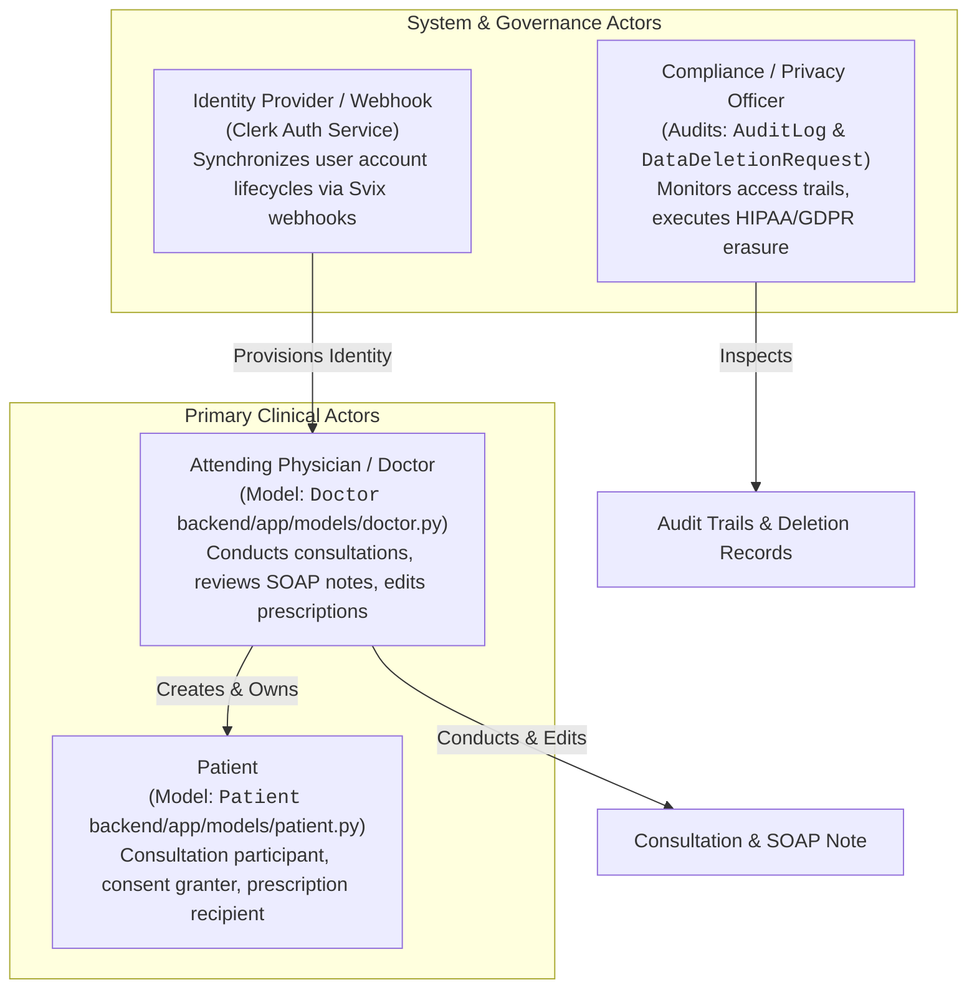

# ClearNote Product Requirements Document (PRD)

This document specifies the clinical and functional requirements of ClearNote as implemented in the codebase. All features, data boundaries, and personas are derived directly from the code repository.

---

## 1. Clinical Problem Statement & Executive Summary

Physicians and outpatient clinicians spend up to **50% of their working day** navigating Electronic Health Record (EHR) interfaces, manually transcribing consultation dialogues, and formatting clinical notes. This documentation burden leads to:
1. **Severe Clinician Burnout**: Doctors spend more time looking at screens than interacting face-to-face with patients.
2. **Delayed Turnaround**: Consultation notes and prescriptions often sit in draft states for hours or days after the patient encounter.
3. **Adverse Drug Events (ADEs)**: Rapid prescription workflows frequently miss drug-drug interactions or cross-sensitivities with patient allergies when past medical history is siloed.

**ClearNote** automates the documentation lifecycle:
- Captures audio during consultations in real-time or via prerecorded uploads.
- Generates structured, standard **SOAP notes** (Subjective, Objective, Assessment, Plan) and ICD-10 diagnostic proposals using speech-to-text (`Deepgram Nova-3 Medical`) and clinical LLM extraction (`Groq llama-3.3-70b-versatile`, fallback `llama-3.1-8b-instant`).
- Automatically intercepts medication lists and verifies them against clinical guidelines using **Retrieval-Augmented Generation (RAG)** and local vector embeddings (`FastEmbed nomic-embed-text-v1.5` on pgvector).
- Generates downloadable, patient-ready PDF prescriptions (`WeasyPrint`) and dispatches them via email/SMS.

---

## 2. Personas & Stakeholders

Based on the models (`backend/app/models/`), routes, and UI implementations, ClearNote acknowledges the following actors:

> [!NOTE]
> **Code Truth on Roles & RBAC**:
> The `Doctor` entity (`backend/app/models/doctor.py`) has **no role column** (e.g. `role: "admin" | "doctor" | "nurse"`). All authenticated Clerk accounts map directly to a single `Doctor` profile. There is currently no multi-tenant organizational structure (e.g., clinic, hospital system, department) or role-based delegation (nurse, medical assistant, billing specialist).

### 2.1 Persona Details

1. **Attending Physician / Clinician (`Doctor`)**:
   - *Needs*: High-speed, frictionless audio recording; instant SOAP drafts; zero hallucinated prescriptions; explicit interaction warnings before signing off.
   - *Actions*: Onboarding profile completion, patient registration, recording start/stop, SOAP note review & inline editing, PDF generation, patient notification trigger.
2. **Patient (`Patient`)**:
   - *Needs*: Privacy protection, explicit consent tracking, legible and accessible prescriptions with clear dosage instructions.
   - *Actions*: Provides consultation consent, receives prescription notifications via SMS/email, accesses prescription PDFs.
3. **Compliance / Privacy Officer (`AuditLog`, `DataDeletionRequest`)**:
   - *Needs*: Immutability of medical records, verifiable access logging, HIPAA BAA compliance, automated "Right to Erasure" handling.
   - *Actions*: Reviews `audit_logs` table, audits deletion requests (`data_deletion_requests`).

---

## 3. Goals & Non-Goals

### 3.1 Product Goals
- **Real-Time Clinical Speech Capture**: Achieve high-accuracy medical terminology transcription via specialized medical speech models (`nova-3-medical`).
- **Standardized Clinical Structuring**: Deliver structured SOAP notes, ICD-10 coding, and discrete medication lists formatted in strict JSON within < 15 seconds of consultation conclusion.
- **Automated Pharmacological Safety Guardrails**: Run semantic similarity searches against ingested clinical guidelines to detect and surface drug-drug and drug-allergy interactions (`CRITICAL`, `WARNING`, `INFO`).
- **Human-in-the-Loop Verification**: Require the clinician to review, edit, and approve all AI-extracted clinical entities before generating legal PDF prescriptions.
- **HIPAA/GDPR Privacy Compliance**: Record explicit patient consent timestamps, support complete data erasure cascades, and maintain audit logs.

### 3.2 Non-Goals (Out of Scope in Current Implementation)
- **Autonomous Clinical Decision Making**: ClearNote does **not** diagnose conditions or prescribe medications autonomously. It is strictly a documentation accelerator.
- **Direct EHR Integration / Bi-Directional FHIR Sync**: ClearNote does not yet sync directly with Epic, Cerner, or AthenaHealth via FHIR R4 APIs.
- **Multi-Tenant Hospital Billing**: ClearNote does not calculate insurance claims, copays, or CPT billing codes.
- **Patient Direct Ingestion / Telehealth Video**: ClearNote captures audio only; it does not host two-way video calls or provide patient portal logins.

---

## 4. Feature Matrix Mapped to Codebase

| Feature Area | Specific Capability | Code Implementation File & Line | Status |
| :--- | :--- | :--- | :--- |
| **Authentication** | Clerk JWT Bearer Authentication | `backend/app/api/dependencies/auth.py:27` | Implemented |
| | Clerk Webhook User Synchronization | `backend/app/api/routes/webhooks.py:18` | Implemented |
| **Doctor Profile** | Doctor Onboarding & Profile CRUD | `backend/app/api/routes/doctors.py:25` | Implemented |
| | Doctor Consultation & Patient Stats | `backend/app/api/routes/doctors.py:84` | Implemented |
| **Patient Care** | Patient Creation with Allergy & Med Arrays | `backend/app/api/routes/patients.py:18` | Implemented |
| | HIPAA/Clinical Consent Recording | `backend/app/models/patient.py:19` | Implemented |
| | Patient Roster Search & Detail View | `backend/app/api/routes/patients.py:33` | Implemented |
| **Audio Capture** | Live WebSocket Audio Streaming to Deepgram | `backend/app/api/routes/consultations.py:128` | Implemented |
| | Prerecorded Audio File Upload (Multipart) | `backend/app/api/routes/consultations.py:59` | Implemented |
| | S3 Encrypted Audio Object Storage | `backend/app/services/s3_service.py:75` | Implemented |
| **AI Documentation** | Clinical SOAP Extraction (`llama-3.3-70b-versatile` / `8b` fallback) | `backend/app/services/llm_service.py:19` | Implemented |
| | ICD-10 Diagnostic Code Suggestion | `backend/app/prompts/soap_extraction.py` | Implemented |
| | Discrete Medication Entity Extraction | `backend/app/models/medication.py:1` | Implemented |
| **Safety & RAG** | Guideline Ingestion & Local Embeddings | `backend/app/services/rag_service.py:49` | Implemented |
| | HNSW Cosine Vector Similarity Retrieval | `backend/app/services/rag_service.py:165` | Implemented |
| | Multi-Drug Interaction Grading (`NONE`/`MILD`/`MODERATE`/`SEVERE`) | `backend/app/services/rag_service.py:140` | Implemented |
| **Prescriptions** | Printable WeasyPrint PDF Compilation | `backend/app/services/pdf_service.py:20` | Implemented |
| | S3 Upload & Pre-signed URL Generation | `backend/app/services/s3_service.py` | Implemented |
| | Public Prescription View Route (HMAC Token) | `backend/app/api/routes/consultations.py:34` | Implemented |
| | Transactional Email (SendGrid) & SMS (Twilio) | `backend/app/services/notification_service.py`| Implemented |
| **Privacy & Erasure**| GDPR / HIPAA Right to Erasure Workflow | `backend/app/api/routes/data_deletion.py:20` | Implemented |
| | Request Access Audit Middleware | `backend/app/middleware/security_header.py` | Implemented |

---

## 5. User Stories & Acceptance Criteria

### US-01: Real-Time Audio Streaming Consultation
**As an** attending physician,  
**I want to** stream audio directly from my clinic workstation microphone during a consultation,  
**So that** an accurate real-time transcript is captured without manual typing.

- **Scenario: Successful audio streaming**
  - *Given* an authenticated clinician has created a consultation for an existing patient with consent recorded,
  - *When* the clinician clicks "Start Recording" in `AudioRecorderModal.tsx`,
  - *Then* a WebSocket connection opens to `/consultations/{id}/stream`,
  - *And* audio chunks are forwarded to Deepgram `nova-3-medical`,
  - *And* interim transcription events are received and displayed with `< 500ms` latency,
  - *And* when "Finish" is clicked, audio is stored in S3 and consultation status transitions to `AUDIO_UPLOADED`.

### US-02: Automated Clinical SOAP & Interaction Extraction
**As an** attending physician,  
**I want** the system to automatically analyze the consultation transcript,  
**So that** I receive a structured draft containing Subjective, Objective, Assessment, Plan, proposed medications, and drug interaction warnings.

- **Scenario: Successful extraction and safety check**
  - *Given* a consultation audio stream has been uploaded to S3 and `_run_transcription` is triggered,
  - *When* background processing executes,
  - *Then* Deepgram `nova-3-medical` transcribes the audio and `llama-3.3-70b-versatile` (with `llama-3.1-8b-instant` fallback) outputs structured JSON matching the clinical schema,
  - *And* pairwise medication combinations are checked against clinical guidelines via `pgvector` HNSW cosine search (`limit 3`),
  - *And* consultation status transitions to `AWAITING_REVIEW` with new rows inserted into `soap_notes`, `medications`, `diagnoses`, and `interactions`, requiring clinician approval (`POST /consultations/{id}/approve` -> `COMPLETE`) before prescription generation.

### US-03: Prescription PDF Generation & Dispatch
**As an** attending physician,  
**I want to** generate a formal, signed PDF prescription and send it directly to my patient,  
**So that** the patient can present it to a pharmacy immediately.

- **Scenario: Clinician generates and sends prescription**
  - *Given* a consultation in `COMPLETE` status with a SOAP note,
  - *When* the doctor triggers `POST /consultations/{id}/prescription`,
  - *Then* WeasyPrint compiles the HTML template with the doctor's license, clinic address, patient details, signature, and medication instructions,
  - *And* the PDF is uploaded to `PDF_BUCKET_NAME`,
  - *And* if the patient has an email, SendGrid dispatches a secure signed link,
  - *And* the endpoint returns a pre-signed download URL, signed token, and shareable URL.

### US-04: Patient Data Deletion (Right to Erasure)
**As a** compliance officer or patient,  
**I want to** submit a formal data deletion request,  
**So that** all clinical records, audio files, and prescriptions are permanently purged in compliance with privacy regulations.

- **Scenario: Patient record erasure**
  - *Given* an authenticated doctor submits `POST /data-deletion/` with a valid `patient_id`,
  - *When* the deletion job executes via `POST /data-deletion/{id}/process`,
  - *Then* S3 audio files and PDF prescriptions are deleted via Boto3,
  - *And* consultations, SOAP notes, medications, diagnoses, and patient records are deleted in a transactional cascade,
  - *And* the request status is marked `PROCESSED` in `data_deletion_requests`.

---

## 6. Success Metrics & Performance Benchmarks

| Metric | Target | Measurement Status |
| :--- | :--- | :--- |
| **Transcription Latency** | `< 600ms` interim word latency | Target SLA (not measured in offline CI suite) |
| **Clinical Extraction Latency** | `< 4.5 seconds` end-to-end | Target SLA (not measured in offline CI suite) |
| **Vector Retrieval Latency** | `< 60ms` per query | Target SLA via FastEmbed + pgvector HNSW |
| **Prescription Generation** | `< 1.2 seconds` | Target SLA via WeasyPrint + S3 |
| **SOAP Entity Extraction Eval** | Med Recall $\ge 95\%$, ICD-10 $\ge 90\%$, Allergy $100\%$ | Enforced in `backend/tests/evals/test_clinical_evals.py` (with mocked Groq responses) |
| **RAG Retrieval Accuracy** | Recall@3 $\ge 90\%$, Precision@3 $\ge 30\%$, MRR $\ge 80\%$ | Measured in `backend/tests/evals/test_rag_retrieval_evals.py` (`12` labelled queries / `18` chunks: `Precision@3 = 0.3333`, `Recall@3 = 1.0000`, `MRR = 1.0000`) |

---

## 7. Compliance & Regulatory Assumptions

1. **HIPAA Security & Privacy Rule**:
   - Audio files and PDFs contain Protected Health Information (PHI) and must be encrypted at rest (S3 SSE-S3/KMS) and in transit (TLS 1.3).
   - Business Associate Agreements (BAAs) are legally required with external cloud vendors: Clerk (Auth), Deepgram (Audio STT), Groq (LLM Inference), Neon (PostgreSQL), AWS (S3), SendGrid/Twilio.
2. **Auditability (45 CFR § 164.312(b))**:
   - The platform must record date/time of access, identity of the clinician, and the specific patient record accessed.
3. **Medical Device Disclaimer (FDA / EU MDR)**:
   - ClearNote operates under the Clinical Decision Support (CDS) exemption. The system is an administrative documentation aid; the licensed clinician retains full legal responsibility for reviewing, modifying, and approving all medical records and prescriptions.
