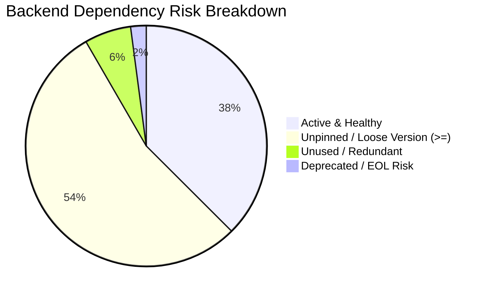

# ClearNote Technology Stack & Dependency Audit

This document inventories all runtime and development dependencies across the ClearNote backend and frontend, detailing their specific purpose, clinical workflow rationale, and architectural risk analysis (deprecated, unpinned, or redundant packages).

---

## 1. Backend Technology Stack (`backend/`)

Runtime: **Python 3.12+** | Package Manager: **uv / pip** (`pyproject.toml`) | Framework: **FastAPI 0.115+** / **Starlette**

### 1.1 Core Backend Dependencies

| Package | Version Spec | Purpose | Rationale & Code Usage |
| :--- | :--- | :--- | :--- |
| `fastapi` | `>=0.136.3` | Core Web & API Framework | High-performance async ASGI REST API and native WebSocket routing (`backend/app/main.py:1`). |
| `uvicorn[standard]` | `>=0.48.0` | ASGI Production Server | Production HTTP/1.1 and WebSocket server loop (uvloop, httptools). |
| `sqlalchemy[asyncio]` | `>=2.0.50` | Async ORM & SQL Dialect | Declarative clinical schema definitions and async database transactions via `AsyncSession` (`backend/app/db/session.py:17`). |
| `asyncpg` | `>=0.31.0` | PostgreSQL Driver | High-throughput asynchronous PostgreSQL client optimized for Neon serverless pooler. |
| `alembic` | `>=1.18.4` | DB Migrations | Revision-controlled schema migrations for 10 clinical tables and pgvector extension (`backend/alembic/`). |
| `pgvector` | `>=0.2.1` | Vector Storage Integration | SQLAlchemy extension type providing native SQL operations (`<=>` cosine distance) for RAG (`backend/app/models/guideline_chunk.py:11`). |
| `pydantic` | `>=2.13.4` | Data Validation & Schemas | Clinical input validation, JSON schema generation, and payload serialization (`backend/app/schemas/`). |
| `pydantic-settings` | `>=2.14.1` | Environment & Config | 12-factor configuration management loading `.env` securely (`backend/app/core/config.py:10`). |
| `python-dotenv` | `>=1.2.2` | Local Environment Loader | Parses local `.env` files into OS environment during development. |

### 1.2 Clinical AI, Speech & Document Processing

| Package | Version Spec | Purpose | Rationale & Code Usage |
| :--- | :--- | :--- | :--- |
| `deepgram-sdk` | `>=7.3.1` | Speech-to-Text (STT) Client | Transcribes live WebSocket audio streams and prerecorded consultation files using `nova-3-medical` model (`backend/app/services/deepgram_service.py:24`). |
| `groq` | `>=1.4.0` | High-Speed LLM Inference | Low-latency inference for structured SOAP extraction (`llama-3.1-8b-instant`) and drug interaction verification (`llama-3.3-70b-versatile`) (`backend/app/services/llm_service.py:16`). |
| `fastembed` | `>=0.9.1` | Local Dense Embeddings | On-premise / host-CPU vector embedding (`nomic-ai/nomic-embed-text-v1.5`, 768-dim) eliminating external latency and token cost for RAG (`backend/app/services/rag_service.py:26`). |
| `langchain-text-splitters`| `>=0.0.1`| Document Chunking | Chunks clinical guidelines into 1000-character segments with 200-character overlap for vector search (`backend/app/services/rag_service.py:38`). |
| `weasyprint` | `>=69.0` | Headless PDF Generation | Renders pixel-perfect, printable clinical prescriptions from HTML+CSS templates (`backend/app/services/pdf_service.py:17`). |
| `jinja2` | `>=3.1.6` | HTML Template Rendering | Injects doctor, patient, and medication variables into `prescription_template.html` (`backend/app/services/pdf_service.py:18`). |

### 1.3 Infrastructure, Storage, Auth & Networking

| Package | Version Spec | Purpose | Rationale & Code Usage |
| :--- | :--- | :--- | :--- |
| `boto3` | `>=1.43.30` | AWS S3 Object Storage SDK | Uploads and downloads consultation audio recordings and generated PDF prescriptions (`backend/app/services/s3_service.py:27`). |
| `clerk-backend-api` | `>=5.0.7` | Identity Management | Clerk administration and session token validation (`backend/app/api/dependencies/auth.py`). |
| `python-jose[cryptography]`| `>=3.5.0`| JWT Verification | Decodes and validates RS256 JWT tokens using Clerk JWKS public keys (`backend/app/api/dependencies/auth.py:44`). |
| `upstash-redis` | `>=1.7.0` | Serverless Redis Client | REST-based Redis client for distributed cache-aside operations (`backend/app/services/cache_service.py:18`). |
| `httpx` | `>=0.28.1` | Async HTTP Client | Asynchronous HTTP calls for Clerk JWKS fetching and webhook notifications. |
| `svix` | `>=1.95.1` | Webhook Verification | Cryptographic verification of incoming Clerk authentication webhooks (`backend/app/api/routes/webhooks.py:18`). |
| `python-multipart` | `>=0.0.32` | Form Data Parser | Handles multipart/form-data uploads for consultation audio file uploads (`backend/app/api/routes/consultations.py:59`). |
| `email-validator` | `>=2.3.0` | Email Validation | RFC-compliant email string validation across doctor and patient schemas. |
| `slowapi` | `>=0.1.10` | Rate Limiting Engine | Declared in pyproject; intended for token bucket API rate limiting. |

### 1.4 Backend Development & Test Dependencies

| Package | Version Spec | Purpose |
| :--- | :--- | :--- |
| `pytest` | `>=9.0.3` | Test Runner & Assertion Framework |
| `pytest-asyncio` | `>=1.4.0` | Asynchronous test coroutine execution for async FastAPI routes |
| `pytest-mock` | `>=3.15.1` | Fixture-based mocking of third-party APIs (Groq, Deepgram, S3) |
| `aiosqlite` | `>=0.22.1` | In-memory SQLite async driver for unit tests |
| `faker` | `>=40.19.1` | Synthetic clinical test data generation (names, ICD-10 mock entries) |

---

## 2. Frontend Technology Stack (`frontend/`)

Runtime: **Node.js 20+** | Framework: **Next.js 16.2.6** | View Library: **React 19.2.4** | Styling: **Tailwind CSS v4**

### 2.1 Core Frontend Dependencies

| Package | Version Spec | Purpose | Rationale & Code Usage |
| :--- | :--- | :--- | :--- |
| `next` | `16.2.6` | App Router & React Framework | Server and client routing, Turbopack bundling, API proxying (`frontend/src/app`). |
| `react` & `react-dom` | `19.2.4` | Modern UI Foundation | React 19 concurrent features, transitions, and component lifecycle. |
| `@clerk/nextjs` | `^7.4.2` | Authentication UI & Hooks | Clerk provider, `<SignIn />`, `<SignUp />`, `useUser()`, and token injection (`frontend/src/app/layout.tsx`). |
| `@tanstack/react-query`| `^5.101.0` | Server State Management | Async data fetching, caching, optimistic updates, and cache invalidation (`frontend/src/features/`). |
| `@tanstack/react-query-devtools`| `^5.101.0`| Cache Debugging | In-browser React Query cache inspection during development. |
| `zod` | `^4.4.3` | Client Form Validation | Form schema definitions and runtime data parsing (`frontend/src/features/doctor/validations.ts`). |
| `react-hook-form` | `^7.78.0` | Form State Management | Controlled form handling for doctor onboarding and patient registration. |
| `@hookform/resolvers` | `^5.4.0` | Form Validation Bridge | Glues Zod validation schemas into React Hook Form. |

### 2.2 Styling, Components & Animation

| Package | Version Spec | Purpose | Rationale & Code Usage |
| :--- | :--- | :--- | :--- |
| `tailwindcss` | `^4` | Utility-First CSS | Tailwind CSS v4 engine configured via `@tailwindcss/postcss`. |
| `@base-ui/react` | `^1.6.0` | Unstyled UI Primitives | Accessible headless dialogs, popovers, and disclosure widgets. |
| `lucide-react` | `^1.17.0` | Clinical & System Icons | Medical and navigation iconography (Stethoscope, Activity, FileText, User). |
| `sonner` | `^2.0.7` | Toast Notifications | Accessible status toasts for consultation updates and error alerts (`frontend/src/components/ui/sonner.tsx`). |
| `next-themes` | `^0.4.6` | Dark/Light Mode Switcher | Manages system/light/dark color scheme state persistence. |
| `clsx` & `tailwind-merge`| `^2.1.1` / `^3.6.0`| Class Name Composition | Conditional CSS class merging avoiding Tailwind specificity conflicts (`frontend/src/lib/utils.ts`). |
| `class-variance-authority`| `^0.7.1` | Component Variants | Type-safe design variant generation for buttons, badges, and modals. |
| `animejs` | `^4.5.0` | UI Motion & Transitions | Timeline animations for landing page hero and dashboard micro-interactions. |
| `lenis` | `^1.3.23` | Smooth Scrolling | Smooth inertial scrolling on marketing and landing routes (`frontend/src/app/ui/SmoothScroll.tsx`). |
| `tw-animate-css` | `^1.4.0` | CSS Keyframe Animations | Prebuilt animation presets for modal reveals and status badges. |

### 2.3 Frontend Development & Testing Dependencies

| Package | Version Spec | Purpose |
| :--- | :--- | :--- |
| `typescript` | `^5` | Strict static typing across routes and components |
| `@playwright/test` | `^1.62.0` | End-to-end browser automation and clinical workflow validation |
| `eslint` & `eslint-config-next`| `^9` / `16.2.6` | Code quality, accessibility, and Next.js Best Practice linting |
| `@types/animejs` | `^3.1.13` | TypeScript type declarations for Anime.js |

---

## 3. Dependency Audit: Redundancies, Deprecations & Risks

### 3.1 Backend Audit Findings

1. **Deprecated Cryptography Library (`python-jose[cryptography]>=3.5.0`)**:
   - *Risk*: `python-jose` has been effectively unmaintained since 2021 and contains unpatched CVE advisories in underlying JOSE algorithms.
   - *Recommendation*: Migrate to `PyJWT>=2.10.1` or use native Clerk JWKS decoding provided by `clerk-backend-api`.
2. **Redundant / Dead Dependencies in `pyproject.toml`**:
   - `google-genai>=2.8.0`: Added to `pyproject.toml` but **never imported or invoked** in any module (the system uses Groq `llama-3.1-8b-instant` and `llama-3.3-70b-versatile`). Adds bloat and security attack surface.
   - `pdfplumber>=0.11.0`: PDF generation is handled by `weasyprint`, and guideline ingestion in `rag_service.py` operates on raw text. `pdfplumber` is not imported anywhere in `backend/app/`.
3. **Declared but Unconfigured Rate Limiting (`slowapi>=0.1.10`)**:
   - *Finding*: `slowapi` is declared in `dependencies`, but `backend/app/main.py` has no Limiter state attached and none of the API routes have `@limiter.limit` decorators. Public and expensive AI endpoints are unprotected from abuse.
4. **Permissive Version Specifiers (`>=`)**:
   - *Finding*: All backend dependencies use `>=` rather than pinned versions (`==`) or strict upper bounds (`~=`). A minor/major release of `fastapi`, `pydantic`, or `deepgram-sdk` could break production builds unpredictably.
5. **Native C-Library Container Dependencies (`weasyprint>=69.0`)**:
   - *Finding*: WeasyPrint depends on host-level dynamic libraries (`libpango-1.0-0`, `libharfbuzz0b`, `libpangoft2-1.0-0`, `libcairo2`). In minimal Alpine or Slim Docker containers, runtime startup will fail with `OSError: cannot load library 'pango-1.0'` unless explicitly installed via apt/apk.

### 3.2 Frontend Audit Findings

1. **CLI Tool Installed in Runtime Dependencies (`shadcn: ^4.13.0`)**:
   - *Risk*: `shadcn` is a development CLI generator tool, yet it is placed under `"dependencies"` in `frontend/package.json`. It inflates production container/bundle size. It should be moved to `"devDependencies"` or removed.
2. **Version Incompatibility: `animejs ^4.5.0` vs `@types/animejs ^3.1.13`**:
   - *Risk*: Anime.js v4 introduced significant API restructuring from v3, while the types package is pinned to v3. This causes TypeScript type definition drift and requires `any` casts in animation code.
3. **Zod v4 Pre-Release (`zod: ^4.4.3`)**:
   - *Risk*: Using pre-release/v4 Zod builds with `@hookform/resolvers` can lead to subtle schema resolution bugs, as standard resolvers are battle-tested against Zod v3.23.x.
