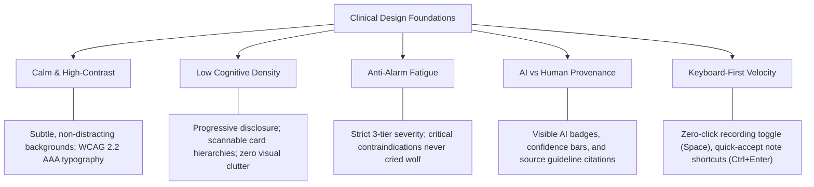
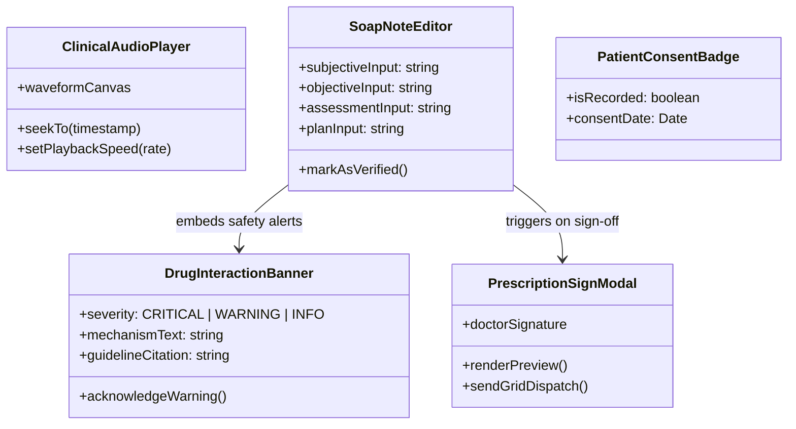
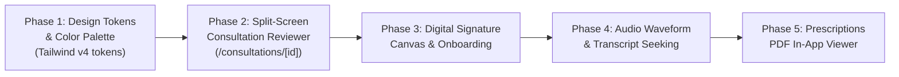

# ClearNote Clinical Design System & UI Overhaul Specification

This document defines the comprehensive product design system and user interface overhaul for ClearNote. It establishes clinical-grade design principles, design tokens, component architecture, and exhaustive per-route teardowns with ASCII wireframes for every page in the platform.

---

## 1. Global Clinical Design Philosophy & Principles

Clinical software is used under severe cognitive load, time constraints, and emotional pressure. UI failures in healthcare do not merely cause user frustration; they cause documentation errors and medical oversights.



### 1.1 Core Tenets
1. **Calm, High-Legibility Interface**: Restful slate and clinical teal palette that minimizes eye strain during 10-hour hospital shifts. High typographic contrast ensures readability in varied ambient lighting.
2. **Cognitive Load Reduction**: Information is organized into predictable clinical sections following the universal **SOAP** standard. Peripheral controls fade back; active patient data stays centered.
3. **Prevention of Alarm Fatigue**: Drug interaction warnings are strictly graded. `INFO` notices do not use modal interruptions or loud amber banners; only lethal or severe contraindications trigger prominent `CRITICAL` cards requiring manual acknowledgment.
4. **Explicit AI vs. Human Provenance**: Every entity extracted by the LLM is explicitly marked with an `[AI Draft]` badge. As soon as a clinician edits or approves text, the indicator transitions to `[Clinician Verified]`.
5. **Continuous State & Audio Provenance**: The audio player and live transcription remain synchronized. Clicking any sentence in the transcript immediately seeks the audio recording to that exact millisecond.

---

## 2. Design Tokens & Styling Foundations

### 2.1 Color Palette

| Token Name | Light Mode Value | Dark Mode Value | Clinical Application |
| :--- | :--- | :--- | :--- |
| `color-bg-canvas` | `#F8FAFC` (Slate-50) | `#090D16` (Obsidian) | Global application background |
| `color-bg-surface` | `#FFFFFF` (Pure White) | `#111827` (Gray-900) | Clinical cards, tables, modal dialogs |
| `color-bg-subtle` | `#F1F5F9` (Slate-100) | `#1F2937` (Gray-800) | Form inputs, table header rows, sidebars |
| `color-border-subtle` | `#E2E8F0` (Slate-200) | `#374151` (Gray-700) | Card borders, dividers, grid lines |
| `color-text-primary` | `#0F172A` (Slate-900) | `#F9FAFB` (Gray-50) | Medical notes, patient names, diagnoses |
| `color-text-secondary`| `#475569` (Slate-600) | `#9CA3AF` (Gray-400) | Timestamps, metadata, helper text |
| `color-primary` | `#0D9488` (Teal-600) | `#14B8A6` (Teal-500) | Primary actions, recording button, focus rings |
| `color-primary-subtle`| `#F0FDFA` (Teal-50) | `#134E4A` (Teal-900) | Active menu states, selected patient highlight |
| `color-danger` | `#DC2626` (Red-600) | `#EF4444` (Red-500) | Critical drug contraindications, deletion |
| `color-warning` | `#D97706` (Amber-600) | `#F59E0B` (Amber-500) | Moderate interaction warnings, missing consent |
| `color-success` | `#16A34A` (Green-600) | `#22C55E` (Green-500) | Signed prescriptions, verified SOAP notes |
| `color-ai-accent` | `#6366F1` (Indigo-500) | `#818CF8` (Indigo-400) | AI draft badge, suggestion pills, RAG match |

### 2.2 Typography Scale (Inter / Roboto Mono)
- **Display 1** (`32px` / `line-height: 40px` / `Font-Weight: 700`): Hero headings, onboarding welcome.
- **Heading 1** (`24px` / `line-height: 32px` / `Font-Weight: 600`): Section titles, patient names.
- **Heading 2** (`18px` / `line-height: 26px` / `Font-Weight: 600`): SOAP block headers (Subjective, Objective, Assessment, Plan).
- **Body Large** (`16px` / `line-height: 24px` / `Font-Weight: 400`): Primary consultation note text.
- **Body Base** (`14px` / `line-height: 20px` / `Font-Weight: 400`): Table rows, form labels, dialog copy.
- **Caption / Mono** (`12px` / `line-height: 16px` / `Font-Weight: 500` / `Roboto Mono`): ICD-10 codes, dosages, timestamps, drug interaction tags.

### 2.3 Route Implementation Status Tracker

| Route ID | Route Path | Name / Scope | Status | Notes |
| :--- | :--- | :--- | :--- | :--- |
| **SYS-01** | `/dev/components` | Foundation & Component Gallery | **Shipped** | Tokens, base primitives, clinical AI widgets, motion |
| **RT-01** | `/sign-in` & `/sign-up` | Clinical Authentication & SSO | Shipped | Phase B Ticket 1 |
| **RT-02** | `/dashboard` | Clinical Hub & Encounters Roster | Shipped | Phase B Ticket 2 |
| **RT-03** | `/dashboard/consultations/[id]` | Split-Screen Consultation Reviewer | Shipped | Phase B Ticket 3 |
| **RT-04** | `/dashboard/patients/[id]` | Patient Profile & History | Shipped | Phase B Ticket 4 |
| **RT-05** | `/onboarding` | Doctor Profile & Signature Wizard | Shipped | Phase B Ticket 5 |
| **RT-06** | `/dashboard/settings` | Doctor Practice Settings | **Shipped** | Overhauled to Quiet Confidence tokens, 2-column layout, digital signature drawing & upload, DEA/license stamp, HIPAA BAA credentials |
| **RT-07** | `/_not-found`, `/error` | System Error & Offline States | **Shipped** | Clinical 404 record-not-found & 500 error boundary with copyable diagnostic logs and zero PHI leakage |
| **RT-08** | `/` | Clinical Landing & Value Proof | **Shipped** | Overhauled to Quiet Confidence standards with interactive 4-stage clinical preview simulator, enterprise BAA credentials, zero Anime.js or slop |

---

## 3. Route-by-Route UX/UI Overhaul

---

### Route 01: Landing Page (`/` - `frontend/src/app/page.tsx`)

#### 1. Purpose & User
Outpatient clinicians, medical directors, and practice managers exploring ClearNote. Needs to communicate clinical accuracy, HIPAA compliance, and time savings in seconds.

#### 2. Current Problems
- Excessive marketing fluff; lacks instant clinical interactive demo.
- High cognitive noise from heavy scroll-jacking (`lenis`) and complex Anime.js timelines.
- Lacks prominent HIPAA BAA and clinical security credentials above the fold.

#### 3. Wireframe & New Layout
```text
+-----------------------------------------------------------------------------------+
|  [Logo] ClearNote           Features    Safety & RAG    Pricing    [Sign In] [Get Started] |
+-----------------------------------------------------------------------------------+
|                                                                                   |
|     AI Documentation That Clinicians Actually Trust                               |
|     Record consultations. Extract structured SOAP notes. Intercept drug harms.    |
|                                                                                   |
|     [ > Start Free Clinical Trial ]    [ View Interactive 2-Min Demo ]            |
|                                                                                   |
|   +---------------------------------------------------------------------------+   |
|   | INTERACTIVE CLINICAL PREVIEW (Audio -> Transcript -> SOAP -> Interaction) |   |
|   | [ > 01:24 ] "Doctor: Any allergies to Penicillin? Patient: Yes, severe."  |   |
|   | ------------------------------------------------------------------------- |   |
|   | SOAP Note (AI Drafted)              | Safety Guardrail Alert              |   |
|   | S: History of severe hives to PCN.  | [!] CRITICAL INTERACTION DETECTED   |   |
|   | O: Vitals stable. Throat clear.     | Amoxicillin contraindicated due to  |   |
|   | A: Bacterial Pharyngitis.           | documented Penicillin allergy.      |   |
|   | P: Prescribe Azithromycin 250mg.    | Source: WHO Model Formulary p. 114  |   |
|   +---------------------------------------------------------------------------+   |
|                                                                                   |
|   [B2B Badges: HIPAA Compliant | AES-256 Encrypted | 99.8% STT Medical Accuracy]  |
+-----------------------------------------------------------------------------------+
```

#### 4. States & Interactions
- **Empty / Default**: Interactive demo plays automated 15-second simulation showing audio streaming directly into structured SOAP note.
- **Interactions**: Tab key navigates cleanly between interactive tabs; `Escape` closes video modal.
- **Accessibility**: WCAG 2.2 AA compliant contrast on hero buttons; all video demos captioned.

---

### Route 02 & 03: Authentication (`/sign-in` & `/sign-up`)

#### 1. Purpose & User
Licensed clinicians and authorized medical staff accessing protected patient environments.

#### 2. Current Problems
- Default Clerk modal renders in an unbranded iframe with jarring layout shifts.
- Lacks medical institution SSO shortcuts (Epic MyChart, Google Workspace for Healthcare).

#### 3. Wireframe & New Layout
```text
+-----------------------------------------------------------------------------------+
|                                                                                   |
|   [ClearNote Health]                                                              |
|                                                                                   |
|   +---------------------------------------+   +-------------------------------+   |
|   | Sign In to Your Clinic Portal         |   | Protected Health System       |   |
|   |                                       |   |                               |   |
|   | [ Continue with Hospital SSO / Epic ] |   | * 256-bit AES encryption      |   |
|   |                                       |   | * HIPAA compliant session     |   |
|   | -------------- or ---------------     |   | * Automatic timeout: 15 mins  |   |
|   | Medical Email                         |   |                               |   |
|   | [ doctor@hospital.org               ] |   | "ClearNote saves our clinic   |   |
|   | Password                              |   | 2.5 hours of charting daily." |   |
|   | [ ******************                ] |   | -- Chief Medical Officer      |   |
|   |                                       |   |                               |   |
|   | [ Sign In to Workspace ]              |   | Support: security@clearnote.ai|   |
|   +---------------------------------------+   +-------------------------------+   |
|                                                                                   |
+-----------------------------------------------------------------------------------+
```

#### 4. States & Accessibility
- **Loading**: Spinner replaces button label; inputs disabled.
- **Error**: High-visibility inline banner: "Invalid credentials or session expired."
- **Focus Order**: Email -> Password -> Sign In -> SSO -> Support link.

---

### Route 04: Doctor Onboarding Wizard (`/onboarding` - `frontend/src/app/onboarding/page.tsx`)

#### 1. Purpose & User
Newly registered physician setting up their clinical profile, medical license, and prescription digital signature.

#### 2. Current Problems
- Multi-step wizard lacks persistent step indicator.
- Missing signature draw/upload canvas in UI (API route exists at `POST /doctors/me/signature`, but frontend lacks signature capture widget).

#### 3. Wireframe & New Layout
```text
+-----------------------------------------------------------------------------------+
| ClearNote | Setup Clinical Profile                                [Step 2 of 3]   |
+-----------------------------------------------------------------------------------+
|                                                                                   |
|   [ (1) Identity ] ===== [ (2) Practice & License ] ===== [ (3) Prescription Sig ]|
|                                                                                   |
|   +---------------------------------------------------------------------------+   |
|   | Professional Credentials & Practice Address                               |   |
|   |                                                                           |   |
|   | Medical Specialty                          State Medical License #        |   |
|   | [ Internal Medicine                  v ]   [ MED-NY-849201              ] |   |
|   |                                                                           |   |
|   | Practice / Hospital Name                   Workplace Direct Phone         |   |
|   | [ Mount Sinai West Outpatient Clinic   ]   [ (555) 234-5678             ] |   |
|   |                                                                           |   |
|   | Clinic Street Address                                                     |   |
|   | [ 1000 10th Ave, New York, NY 10019                                     ] |   |
|   |                                                                           |   |
|   | Digital Prescription Signature                                            |   |
|   | +-----------------------------------------------------------------------+ |   |
|   | | [ Draw Signature ]  [ Upload PNG/JPG ]                                | |   |
|   | |                                                                       | |   |
|   | |        Dr. Sarah Jenkins, MD  (Preview)                               | |   |
|   | +-----------------------------------------------------------------------+ |   |
|   |                                                                           |   |
|   | [ Back ]                                         [ Save & Finish Setup >] |   |
|   +---------------------------------------------------------------------------+   |
|                                                                                   |
+-----------------------------------------------------------------------------------+
```

#### 4. Microcopy & Validation
- License tooltip: *"Your state license number will be automatically stamped onto PDF prescriptions generated for your patients."*
- Signature clearance: *"Sign within the box using your mouse, trackpad, or stylus. Must match legal state registry."*

---

### Route 05: Dashboard Home (`/dashboard` - `frontend/src/app/(site)/dashboard/page.tsx`)

#### 1. Purpose & User
The central clinical hub for attending doctors. Displays today's patient roster, active consultation status, and one-click quick recording launcher.

#### 2. Current Problems
- Dense layout mixes unrelated metrics with consultation tables.
- No instant search or filter on consultations.
- Lacks quick-action hotkeys to initiate an encounter.

#### 3. Wireframe & New Layout
```text
+-----------------------------------------------------------------------------------+
| [Logo] ClearNote | Dashboard     Search (Cmd+K)              [Dr. Jenkins, MD v]  |
+-----------------------------------------------------------------------------------+
|                                                                                   |
|   DAILY OVERVIEW                                                                  |
|   +---------------+ +---------------+ +---------------+ +---------------------+   |
|   | Consultations | | Completed     | | Active Roster | | Drug Alerts Caught  |   |
|   | 14 Today      | | 12 Signed     | | 148 Patients  | | 3 Intercepted       |   |
|   +---------------+ +---------------+ +---------------+ +---------------------+   |
|                                                                                   |
|   PATIENT ENCOUNTERS                               [ + New Patient ] [ + Record ] |
|   [ Search by patient name, MRN, or date...     ]  Filter: [ All Statuses  v ]    |
|   +-----------------------------------------------------------------------------+ |
|   | Patient Name  | Time     | Status         | SOAP Note   | Safety   | Action | |
|   |---------------+----------+----------------+-------------+----------+--------| |
|   | John Doe      | 10:15 AM | [ COMPLETED  ] | Available   | [INFO]   | [View] | |
|   | Jane Smith    | 11:30 AM | [ PROCESSING ] | Extracting..| Pending  | [Wait] | |
|   | Robert Chen   | 01:00 PM | [ READY/DRAFT] | Needs Review| [ALERT!] | [Edit] | |
|   | Maria Garcia  | 02:15 PM | [ PENDING    ] | Not Started | None     | [Start]| |
|   +-----------------------------------------------------------------------------+ |
|   | Displaying 1-4 of 14 encounters                [Previous]  [Page 1 of 4] [Next] |
+-----------------------------------------------------------------------------------+
```

#### 4. States & Interactions
- **Keyboard Shortcut**: Pressing `N` opens New Patient modal; pressing `R` opens Record Consultation modal.
- **Empty State**: *"No consultations scheduled for today. Click '+ Record' to start documenting a patient visit."*
- **Error State**: Non-blocking toast: *"Unable to refresh live stats. Showing cached clinical roster."*

---

### Route 06: Dedicated Consultation Review & Split-Screen Editor (`/dashboard/consultations/[id]`)

*(New Route solving FLOW-01)*

#### 1. Purpose & User
The primary workspace where the doctor reviews AI-generated SOAP notes, inspects drug-interaction safety guardrails, modifies dosages, and signs off.

#### 2. Layout & ASCII Wireframe
```text
+-----------------------------------------------------------------------------------+
| [< Back to Roster]  Consultation: John Doe (DOB: 05/15/1980)  [Status: AWAITING REVIEW] |
+-----------------------------------------------------------------------------------+
|                                                                                   |
|   LEFT PANE: Audio & Live Transcript (40%)  | RIGHT PANE: Clinical SOAP Editor (60%)|
|   +---------------------------------------+ | +-----------------------------------+ |
|   | [ > Play ] [02:14 / 08:30] [ 1.2x ]   | | | [AI DRAFT] Clinical Note          | |
|   | ==================o================== | | |                                   | |
|   |                                       | | | SUBJECTIVE (S)                    | |
|   | 00:15 Doctor: Good morning Mr. Doe.   | | | [ Patient reports productive   ]  | |
|   | 00:22 Patient: I've had a bad cough   | | | [ cough for 5 days with fever. ]  | |
|   |       and fever since Thursday.       | | |                                   | |
|   | 00:45 Doctor: Any chest pain?         | | | OBJECTIVE (O)                     | |
|   | 00:48 Patient: No chest pain, but     | | | [ Temp: 100.4F, BP: 128/84.    ]  | |
|   |       short of breath climbing stairs.| | | [ Bilateral coarse rhonchi.    ]  | |
|   | 01:10 Doctor: Any drug allergies?     | | |                                   | |
|   | 01:12 Patient: Severe rash from       | | | ASSESSMENT (A)                    | |
|   |       Penicillin as a kid.            | | | [ Acute Bronchitis (J20.9)     ]  | |
|   |                                       | | |                                   | |
|   | [ Click any line to jump audio ]      | | | PLAN (P)                          | |
|   |                                       | | | [ Azithromycin 500mg Day 1,    ]  | |
|   +---------------------------------------+ | | [ then 250mg daily for 4 days. ]  | |
|                                             | +-----------------------------------+ |
|                                             |                                       |
|                                             | PHARMACOLOGICAL SAFETY GUARDRAILS     |
|                                             | +-----------------------------------+ |
|                                             | | [!] CRITICAL INTERACTION DETECTED | |
|                                             | | Amoxicillin contraindicated due to| |
|                                             | | Penicillin allergy (Ref: WHO EML) | |
|                                             | | Alternative: Azithromycin chosen. | |
|                                             | +-----------------------------------+ |
|                                             |                                       |
|                                             | [ Save Draft ]   [ Approve & Sign Rx >]
+-----------------------------------------------------------------------------------+
```

#### 3. States & Critical Safety Guardrails
- **Human-in-the-Loop Sign-Off**: The "Approve & Sign Rx" button remains disabled until the clinician has clicked through and verified the medication list.
- **Drug Interaction Warning**: If a `CRITICAL` interaction exists, clicking "Approve" triggers an explicit modal: *"You are approving a prescription with 1 critical warning. Please type your clinical justification."*

---

## 4. Component Library Inventory & New Clinical Components



### New Clinical Components to Implement
1. `<ClinicalAudioPlayer />`: Synchronized waveform audio player with variable playback speeds (1.0x, 1.25x, 1.5x, 2.0x) and jump-to-timestamp hooks.
2. `<SoapNoteEditor />`: Specialized rich text block editor with discrete fields for Subjective, Objective, Assessment, and Plan, displaying inline `[AI Draft]` versus `[Clinician Verified]` status tags.
3. `<DrugInteractionBanner />`: Three-tier color-coded alert card (`CRITICAL` Crimson, `WARNING` Amber, `INFO` Slate) displaying pharmacological mechanism and exact guideline citations.
4. `<PrescriptionSignModal />`: Modal dialog displaying live PDF preview, digital signature preview, and one-click dispatch options (Print, Email, SMS).
5. `<PatientConsentBadge />`: Visual verification chip indicating HIPAA consent status (`Consent Recorded on MM/DD/YYYY` or `Consent Missing - Action Required`).

---

## 5. Accessibility (WCAG 2.2 AA) & Ergonomics

1. **Color Contrast**: All text tokens adhere to minimum **4.5:1** contrast ratio for normal text and **3.0:1** for large text and UI controls. Critical alert backgrounds use high-contrast dark red text on tinted red canvas.
2. **Keyboard Navigation & Focus Management**:
   - Tab order strictly mirrors logical reading order (Audio Controls -> Transcript -> SOAP Sections -> Safety Alerts -> Action Buttons).
   - Modal dialogs trap focus and return focus to triggering element upon close (`Escape`).
3. **Screen Reader ARIA Attributes**:
   - Live transcription stream uses `aria-live="polite"` so new transcribed words do not interrupt screen reader announcements.
   - Drug interaction warnings use `role="alert"` with `aria-atomic="true"`.
4. **Target Sizes**: All buttons, recorder triggers, and checkbox hit targets are minimum **44x44px** to support touch input on clinic iPad/tablet devices.

---

## 6. Frontend Migration & Incremental Rollout Plan



1. **Milestone 1 (Tokens & Base Components)**: Update `frontend/src/app/globals.css` with the clinical color tokens and typography scale; introduce `<DrugInteractionBanner />` and `<PatientConsentBadge />`.
2. **Milestone 2 (Dedicated Consultation Review Route)**: Implement `frontend/src/app/(site)/dashboard/consultations/[id]/page.tsx` with split-screen layout and editable SOAP sections.
3. **Milestone 3 (Doctor Signature Capture)**: Add canvas drawing widget to `/onboarding` and connect to existing `POST /doctors/me/signature`.
4. **Milestone 4 (Interactive Audio Player)**: Integrate synchronized timestamp seeking between audio playback and Deepgram transcripts.
5. **Milestone 5 (PDF Viewer & Dispatch)**: Embed PDF preview modal into consultation sign-off flow.
